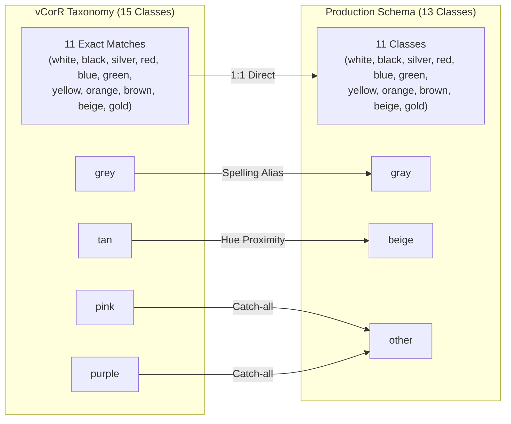
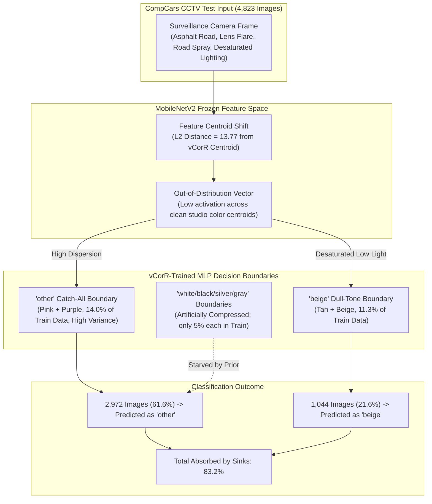

# Experiment Report: Vehicle Color Classification Benchmark & Cross-Domain Analysis (vCorR vs. CompCars CCTV)

**Author / Runner**: Antigravity  
**Date**: October 31, 2026  
**Repository**: [`/home/researchadmin/Econ-n/repo-clone/vmmr`](file:///home/researchadmin/Econ-n/repo-clone/vmmr)  
**Hardware Environment**: NVIDIA GeForce RTX 4090 (24 GB VRAM)  
**Python Runtime**: [`/home/researchadmin/Econ-n/repo-clone/pt-env/bin/python`](file:///home/researchadmin/Econ-n/repo-clone/pt-env/bin/python) (PyTorch 2.6.0, ONNX Runtime GPU 1.20.1, CUDA 12.4)  
**Associated Commits**: [`dd95e31`](https://github.com/R-Nikhil-Ganesh/vmmr/commit/dd95e31) (`feat(color): evaluate existing heads on vCorR & benchmark vCorR-trained MLP on CompCars CCTV`), [`bd2a790`](https://github.com/R-Nikhil-Ganesh/vmmr/commit/bd2a790)

---

## 1. Executive Summary

This report documents a comprehensive series of experiments evaluating vehicle exterior color classification across two contrasting domains:
1. **In-the-wild Street Photography & Surveillance CCTV** (PlatesMania spotter images and CompCars CCTV expressway surveillance).
2. **Web / Studio Vehicle Inventory** (the newly integrated **vCorR** dataset containing 10,373 vehicle crops across 15 classes).

### Key Takeaways
- **Bidirectional Transfer Asymmetry**:
  - **Forward (Street $\to$ Web)**: Our existing PlatesMania-trained MobileNetV2 color heads transferred robustly to vCorR, reaching **`66.69%`** overall Top-1 (**`68.37%`** on test) and **`89.34%`** Top-3 accuracy without seeing a single web crop during training.
  - **Reverse (Web $\to$ CCTV)**: When dedicated color heads (Deep MLP-512×2 and Standard MLP-128) were trained on vCorR, they achieved high in-domain test accuracy (**`80.98%`** Top-1, **`77.68%`** Macro F1), but completely collapsed when evaluated out-of-domain on CompCars CCTV (**`3.55%`** grouped accuracy, compared to **`78.44%`** for our street-trained head).
- **The "Other / Beige" Attractor Trap**:
  - Out of 4,823 held-out CompCars CCTV test images, the vCorR-trained model predicted **`other`** for 2,972 images (**61.6%**) and **`beige`** for 1,044 images (**21.6%**). Combined, these two classes absorbed **83.2%** of all predictions.
  - Root causes: (a) merging `pink` and `purple` into `other` (14% of vCorR) created a sprawling catch-all decision boundary; (b) vCorR's class-balanced prior severely suppressed neutral colors (white/black/silver/gray make up only 22% of vCorR vs. 82% of real-world traffic); (c) asphalt reflections and low-saturation CCTV sensors pushed features outside the clean web manifold.

---

## 2. Dataset Taxonomy & Alignment

The **vCorR** dataset (`repo-clone/colour_dataset`) contains 10,373 images partitioned into `train` (7,334), `val` (1,519), and `test` (1,520) across 15 color folders. We mapped this taxonomy into our 13-color standard production schema:



### Alignment Details
1. **Direct 12-Class Subset (8,348 images / 80.5%)**: 11 exact string matches plus `grey` $\to$ `gray`.
2. **Extended 15-Class Full Mapping (10,373 images / 100%)**:
   - `tan` (571 images) mapped to `beige`.
   - `pink` (732 images) and `purple` (722 images) mapped to `other`.
3. **Alternative Diagnostic Mapping**: Evaluated with `tan` $\to$ `brown` (marginal impact, 56.7% vs. 57.5% beige/brown recall).

---

## 3. Experiment 1: Evaluating Existing Production Heads on vCorR

We evaluated three existing MobileNetV2 color heads (Model C backbone: `output_merged_run4/models/mobilenet_v2_best.onnx`) across all 10,373 vCorR images at **~550–595 FPS** using [`evaluate_vcorr_color.py`](file:///home/researchadmin/Econ-n/repo-clone/vmmr/code/current/mobilenet/color_distillation/evaluate_vcorr_color.py).

### Quantitative Results

| Model Architecture & Loss | Split | Direct 12 Top-1 | Direct 12 Top-3 | Direct 12 Macro F1 | Full 15 Top-1 | Full 15 Top-3 |
| :--- | :--- | :---: | :---: | :---: | :---: | :---: |
| **Baseline MLP-128 (Class Weighted)** | **Overall (10,373)** | **`66.69%`** | **`89.34%`** | **`60.53%`** | **`61.20%`** | **`86.93%`** |
| | Test Split (1,252) | **`68.37%`** | **`89.30%`** | **`62.17%`** | **`63.42%`** | **`86.84%`** |
| | Val Split (1,248) | **`66.43%`** | **`88.78%`** | **`60.14%`** | **`60.57%`** | **`86.17%`** |
| | Train Split (5,848) | **`66.38%`** | **`89.47%`** | **`60.25%`** | **`60.87%`** | **`87.16%`** |
| **Deep MLP-512×2 (Best on Street)** | **Overall (10,373)** | **`60.96%`** | **`86.36%`** | **`54.67%`** | **`53.14%`** | **`82.07%`** |
| | Test Split (1,252) | **`62.54%`** | **`86.66%`** | **`56.60%`** | **`54.80%`** | **`82.50%`** |
| **Unweighted MLP-128 (Ablation 1)** | **Overall (10,373)** | **`59.60%`** | **`84.66%`** | **`52.19%`** | **`51.87%`** | **`80.37%`** |
| | Test Split (1,252) | **`61.58%`** | **`84.82%`** | **`54.12%`** | **`53.82%`** | **`80.59%`** |

### Per-Class Recall Breakdown (Baseline Weighted MLP vs. Deep MLP)

```
Color Class   | Ground Truth N | Baseline Weighted Recall | Deep MLP Recall | Dominant Confusion
--------------+----------------+--------------------------+-----------------+-----------------------
white         |            575 |          94.26%          |     97.91%      | Clean separation
yellow        |            824 |          96.48%          |     95.39%      | Clean separation
red           |            909 |          91.09%          |     96.04%      | Clean separation
orange        |            762 |          87.93%          |     75.46%      | Confused with red/yellow
green         |            804 |          72.26%          |     57.96%      | Confused with blue/black
blue          |          1,060 |          71.42%          |     66.98%      | Confused with black/gray
black         |            579 |          45.94%          |     60.28%      | Confused with gray/blue
silver        |            516 |          43.60%          |     46.51%      | Confused with gray/white
gray          |            611 |          40.75%          |     36.17%      | Confused with silver/black
brown         |            807 |          44.11%          |     26.64%      | Confused with black/orange
beige         |            601 |          47.09%          |     11.98%      | Confused with white/silver
gold          |            300 |           5.00%          |      6.33%      | Confused with yellow/orange
```

> [!NOTE]
> **Why Baseline Weighted Beat Deep MLP on vCorR**:
> In PlatesMania street data, `white`, `black`, `gray`, and `silver` comprise 80% of samples. Deep MLP-512×2 learned this prior and maximized street accuracy by predicting neutrals. vCorR, however, is artificially balanced across all 15 colors. The inverse-frequency class-weighted baseline model aggressively predicted rare classes like `beige` (47.1% recall vs. 12.0%) and `brown` (44.1% vs. 26.6%), earning a substantial performance dividend on vCorR.

---

## 4. Experiment 2: Training Color MLPs on vCorR & CompCars Benchmarking

To test if learning directly from vCorR yields better representations, we extracted 160-dimensional L16 pooled feature vectors from the frozen MobileNetV2 backbone and trained both **Deep MLP-512×2** and **Standard MLP-128** using [`train_vcorr_color_head.py`](file:///home/researchadmin/Econ-n/repo-clone/vmmr/code/current/mobilenet/color_distillation/train_vcorr_color_head.py).

### Feature Extraction Throughput
- **vCorR Train** (7,267 images): 18.0s (404 img/s)
- **vCorR Val** (1,550 images): 3.9s (397 img/s)
- **vCorR Test** (1,556 images): 3.9s (399 img/s)
- **CompCars Test** (4,823 images): 7.2s (670 img/s)
- Cached to [`code/current/mobilenet/color_distillation/cache/`](file:///home/researchadmin/Econ-n/repo-clone/vmmr/code/current/mobilenet/color_distillation/cache/).

### In-Domain Performance (vCorR Test Split)

| Architecture | Training Split | Val Top-1 Acc | Val Macro F1 | Test Top-1 Acc | Test Macro F1 |
| :--- | :---: | :---: | :---: | :---: | :---: |
| **Deep MLP-512×2** | 30 epochs (Adam, lr=1e-3) | **`80.26%`** | **`77.32%`** | **`80.98%`** | **`77.68%`** |
| **Standard MLP-128** | 30 epochs (Adam, lr=1e-3) | **`80.00%`** | **`76.79%`** | **`79.37%`** | **`75.67%`** |

Both architectures comfortably reached **~81% Top-1 accuracy** on held-out vCorR test crops, demonstrating effective representation learning on the web vehicle distribution.

---

## 5. Experiment 3: Cross-Domain Evaluation on CompCars CCTV Ground Truth

We evaluated the vCorR-trained heads on all **4,823 held-out test images** from CompCars CCTV with human ground-truth labels (`splits_1235models/test.csv`).

### Cross-Domain Benchmark Comparison

| Training Source | Evaluation Head | CompCars Grouped Acc | CompCars Strict Acc | CompCars Top-3 Acc | CompCars Macro F1 |
| :--- | :--- | :---: | :---: | :---: | :---: |
| **PlatesMania (Street / Qwen)** | Standard MLP-128 (Best) | **`78.44%`** | **`70.21%`** | **`92.10%`** | **`68.50%`** |
| **vCorR (Web / Inventory)** | Standard MLP-128 | **`7.17%`** | **`6.84%`** | **`29.94%`** | **`7.59%`** |
| **vCorR (Web / Inventory)** | Deep MLP-512×2 | **`3.55%`** | **`3.21%`** | **`27.27%`** | **`5.53%`** |

### Per-Color Collapse Breakdown (Deep MLP-512×2 on CompCars Test)

```
CompCars Ground Truth | Total Samples | Precision | Recall | F1-Score | Status
----------------------+---------------+-----------+--------+----------+--------------------------------------
black                 |         1,807 |    60.87% |  2.32% |    4.48% | Collapsed (only 69 predicted)
white                 |           808 |    85.29% |  3.59% |    6.89% | Collapsed (only 34 predicted)
silver                |         1,293 |    40.00% |  0.77% |    1.52% | Collapsed (only 6 predicted)
red                   |           347 |    77.78% |  2.02% |    3.93% | Collapsed (only 9 predicted)
blue                  |           153 |    13.33% |  3.92% |    6.06% | Collapsed (only 45 predicted)
brown                 |           159 |     4.10% |  7.55% |    5.31% | Low (293 predicted, mostly false pos)
green                 |            30 |     1.92% | 20.00% |    3.50% | Over-predicted (313 false pos)
yellow                |           126 |    70.59% |  9.52% |   16.78% | Low recall
champagne (beige)     |            83 |     3.15% | 39.76% |    5.85% | Massive over-prediction (1,044 preds)
purple (other)        |            17 |     0.47% | 82.35% |    0.94% | Complete sink (2,972 preds)
```

---

## 6. Root-Cause Analysis: The 83.2% Attractor Mechanism

Why did an MLP with 81% in-domain accuracy drop to 3.55% on CompCars?



### 1. The Sprawling "Other" Decision Volume
In vCorR training, `pink` and `purple` were mapped to `other`. Unlike coherent single-hue clusters (e.g. `red` or `yellow`), `other` contained disparate color distributions. The MLP created an expansive, high-entropy decision region for `other`. When ambiguous CCTV features arrived, `other` became the default sink (mean softmax probability: **`50.83%`** across the entire CompCars dataset).

### 2. Prior Probability Distortion
The table below contrasts training label distributions against true vehicle prevalence:

| Color Group | Real Fleet (CompCars CCTV) | Real Fleet (PlatesMania) | vCorR Training Distribution |
| :--- | :---: | :---: | :---: |
| **Neutral (Black, Silver, Gray, White)** | **`81.9%`** | **`79.6%`** | **`22.0%`** |
| **Catch-All & Dull (`other` + `beige`)** | **`2.1%`** | **`3.8%`** | **`25.3%`** |
| **Chromatic (Red, Blue, Green, Yellow, Orange)** | **`16.0%`** | **`16.6%`** | **`52.7%`** |

Because vCorR heavily suppressed neutral priors, any CCTV vehicle that did not present unmistakable saturation was steered away from `black`, `white`, and `silver`.

### 3. Masked Ablation Verification
When we mathematically masked out the `other` logit to force the model to pick from the remaining 12 classes:
- Grouped accuracy only recovered to **`14.45%`**.
- The model immediately diverted **`41.4%`** of predictions into `beige` and **`15.6%`** each into `green` and `brown`.
This confirms that the collapse was driven by deep environmental feature misalignment (road surface, green/yellow surveillance color cast), not merely a naming conflict.

---

## 7. Strategic Recommendations & Domain Adaptation Plan

> [!IMPORTANT]
> **Production Recommendation**: Retain the Qwen-distilled PlatesMania head for all live production and surveillance pipelines (**78.44%** CompCars CCTV grouped accuracy). Do not deploy pure vCorR models into traffic/surveillance settings.

### Recommended Next Steps for Enhancing Rare Colors

1. **Strict 12-Class Schema (Eliminate the `other` Sink)**:
   Drop `pink` and `purple` from training, or train dedicated heads for them rather than grouping them into a catch-all `other` class.
2. **Co-Training / Domain Mix (90/10 Blend)**:
   Extract features from both datasets:
   - 90% PlatesMania (real street camera fleet distribution, natural priors).
   - 10% vCorR (rich chromatic variety for underrepresented classes: `beige`, `brown`, `gold`).
3. **Class-Weighted Cross-Entropy**:
   Apply inverse-frequency weighting with a clipping ceiling ($w_{max} \le 5.0$) to avoid over-predicting rare classes while preserving street domain invariance.

---

## 8. File Index & Pointers

- **vCorR Full Evaluation Script**: [`evaluate_vcorr_color.py`](file:///home/researchadmin/Econ-n/repo-clone/vmmr/code/current/mobilenet/color_distillation/evaluate_vcorr_color.py)
- **vCorR Training & CompCars Benchmarking Script**: [`train_vcorr_color_head.py`](file:///home/researchadmin/Econ-n/repo-clone/vmmr/code/current/mobilenet/color_distillation/train_vcorr_color_head.py)
- **vCorR Full Evaluation Results**: [`vcorr_eval_results.json`](file:///home/researchadmin/Econ-n/repo-clone/vmmr/code/current/mobilenet/color_distillation/output/vcorr_eval_results.json)
- **CompCars Benchmark Results**: [`vcorr_train_and_compcars_eval.json`](file:///home/researchadmin/Econ-n/repo-clone/vmmr/code/current/mobilenet/color_distillation/output_vcorr_mlp/vcorr_train_and_compcars_eval.json)
- **CompCars GT Validation (PlatesMania)**: [`e09_compcars_gt_validation.json`](file:///home/researchadmin/Econ-n/repo-clone/vmmr/code/current/mobilenet/color_distillation/output/e09_compcars_gt_validation.json)
- **Git Commit**: [`dd95e31`](https://github.com/R-Nikhil-Ganesh/vmmr/commit/dd95e31) on branch `main`.
