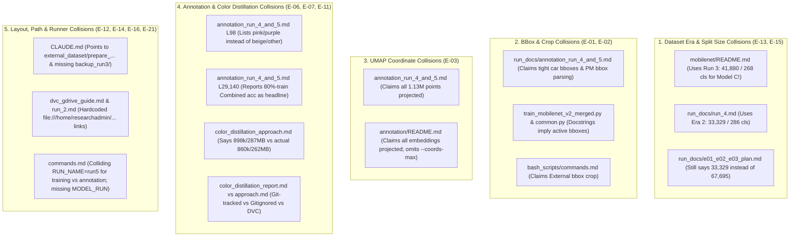

# Implementation Plan: Resolving All Documentation Collisions & Code-Doc Discrepancies

## Goal Description
A cross-repository audit of [`errors.md`](../errors.md), [`e01_e02_e03_plan.md`](e01_e02_e03_plan.md), and all Markdown documentation files (`CLAUDE.md`, `README.md`, `run_docs/*.md`, `annotation/README.md`, `color_distillation/*.md`, `bash_scripts/commands.md`) revealed **7 major categories of documentation collisions** where docs contradict each other, contradict the actual code/data on disk, or conflate three distinct dataset eras (Run 3 vs. Run 4/5 vs. the new 51-Make expansion).

This plan maps out every single collision with exact file and line references and defines the concrete fixes required across documentation and verification scripts.

---

## User Review Required

> [!IMPORTANT]
> **1. Separating the Three Dataset Eras Clearly Across All Docs**:
> Right now, different docs mix numbers from three different generations of `splits_1235models/`:
> - **Era 1 — Run 3 (`backup_run3`, Model B)**: `41,880` External images (`29,554` train / `6,163` val / `6,163` test), `268` train classes (`264` test) across `32` makes; `4,100` Stanford Cars rows had real bounding boxes (`9.8%`).
> - **Era 2 — Run 4 & Annotation Runs 4–5 (`output_merged_run4`, Model C)**: `33,329` External images (`23,589` train / `4,870` val / `4,870` test), `286` classes across `35` makes; `0` bounding boxes (`bbox_* = -1` on `100%` of rows).
> - **Era 3 — Expanded 51-Make + `< 50` Pruned Splits (Current `splits_1235models/`)**: `67,695` External images (`47,805` train / `9,945` val / `9,945` test), `471` External classes (`290` in PM + `181` External-only $\ge 50$ samples) across `49` makes (`1,416` unified classes); `0` bounding boxes (`bbox_* = -1` on `100%` of rows).
>
> We will explicitly label which era each report and README section refers to so historical reports (`run_3.md`, `run_4.md`, `annotation_run_4_and_5.md`) stay historically accurate for the checkpoints they describe while current guides (`README.md`, `CLAUDE.md`, `commands.md`, `e01_e02_e03_plan.md`) document both the Run 4 baseline and the expanded 1,416-class splits.

> [!WARNING]
> **2. Resolving Unverified Technical Claims (`E-01`, `E-02`, `E-03`, `E-06`, `E-07`)**:
> Rather than leaving unverified claims in the docs, we propose:
> - **E-01 (BBoxes)**: Fix all docs/docstrings that falsely claim tight vehicle bounding boxes were used in Model C or Annotation Runs 4–5. Document that `external_resized_512` was pre-letterboxed to 512×512 during dataset creation (`bbox_* = -1` in the split CSVs), so Model C and Qwen used full 512×512 images with domain banner/watermark crops (`15%` top for PlatesMania, `5%` bottom for External).
> - **E-03 (UMAP `NaN`s)**: Update `annotation_run_4_and_5.md` and `annotation/README.md` to state accurately that `stage_coords` computes 2D UMAP coordinates for a `--coords-max 30000` landmark sample (`14,870` rows in Run 4; `30,000` rows = `2.7%` in Run 5) and leaves the remaining `87.0%` / `97.3%` as `NaN` (or optionally project all rows via `reducer.transform` if desired).
> - **E-06 (Bit-for-Bit ONNX Identity)**: Upgrade `color_distillation/verify_multitask_onnx.py` to actually run `np.max(np.abs(...))` comparisons against `output_merged_run4/models/mobilenet_v2_best.onnx` and `color_head_best.pt` on 256 images and record the exact numerical diff in `color_distillation_report.md`.

---

## Master Map of All Documentation Collisions



---

## Detailed Collision Inventory & Proposed Fixes by File

### Component 1: Core MobileNet Overview & Workspace Guides (`E-13`, `E-16`)

#### [MODIFY] [README.md](../README.md)
| Line(s) | Current Colliding / Stale Text | Ground Truth & Proposed Fix |
| :--- | :--- | :--- |
| **10–38** | Directory tree omits `annotation/`, `annotation_runs/`, `color_distillation/`, `bash_scripts/dvc.sh`, `bash_scripts/run_train_color_distillation.sh`, `errors.md`, and `run_docs/run_4.md`+. | Update directory tree to include all active modules, runners, DVC pointers, and `run_docs/` reports. |
| **47–52** | Quick Start omits color distillation (`run_train_color_distillation.sh`) and DVC (`dvc.sh`). | Add both commands to Quick Start. |
| **58–61, 75** | Describes Model C (`merged_dataset/`) using **Run 3's** External stats: *"41,880 curated images across 268 active models and 32 makes (train.csv: 29,554, val.csv: 6,163, test.csv: 6,163) with on-the-fly bounding-box cropping"*. | Separate into: (a) **Run 4 Model C baseline** (`33,329` External images across `286` classes / `35` makes; `23,589` train / `4,870` val / `4,870` test; `1,235` total classes) and (b) **Expanded 51-Make splits** (`67,695` External images across `471` classes / `49` makes; `47,805` train / `9,945` val / `9,945` test; `1,416` total classes with $\ge 50$ samples/class). State clearly that `external_resized_512` has `bbox_* = -1` and uses a `5%` bottom crop. |
| **59** | Lists PlatesMania as `1,093,501` images without noting that `1,093,408` are readable (`93` unreadable across splits; `109,331 / 109,340` readable in test). | Note both manifest row count (`1,093,501`) and readable image count (`1,093,408`). |
| **108** | `--crop-jitter 0.5`: *"randomizes the train-split crop (PlatesMania top crop, External bbox margin / bottom crop)"* | Clarify that in `splits_1235models` (`bbox_* = -1`), `--crop-jitter` randomizes the `15%` top crop (PlatesMania) and `5%` bottom crop (External). |

---

#### [MODIFY] [CLAUDE.md](../../../../CLAUDE.md)
*(Note: `CLAUDE.md` is gitignored per-machine context; we will update the Research PC copy in place).*
| Line(s) | Current Colliding / Stale Text | Ground Truth & Proposed Fix |
| :--- | :--- | :--- |
| **27** | *"Classes are 1235 Make/Model labels (e.g. `Toyota/Corolla`) over 35 makes."* | Note that Run 3/Run 4 models use the base `1,235` classes (`35` makes), while `merged_dataset/splits_1235models/` now extends indices `1235..1415` (`1,416` classes across `49` makes, $\ge 50$ samples/class) for next-generation training. |
| **33** | Lists `platesmania_dataset/train/train_mobilenet_v2.py` and `external_dataset/train/train_mobilenet_v2_external.py` at top level. | Update path to `backup_run3/platesmania_dataset/...` and `backup_run3/external_dataset/...`. |
| **38** | Lists `external_dataset/prepare_external_1235models.py`. | Fix path to `merged_dataset/prepare_external_1235models.py` (`E-16`). |
| **39–42** | Omits `color_distillation/`, `bash_scripts/run_train_color_distillation.sh`, and `bash_scripts/dvc.sh`. | Add `color_distillation/` and `dvc.sh` (ephemeral `DVC_GDRIVE_CLIENT_ID` / `DVC_GDRIVE_CLIENT_SECRET` rule on Research PC). |
| **49** | *"Large binaries (`*.npy`, `color_cache.csv`) in `annotation_runs/` are gitignored; reports (`annotations.csv`) and `viewer.html` are versioned."* | Clarify that `annotation_runs/run4/{annotations.csv,viewer.html}` are in Git, whereas `annotation_runs/run5/` (`3.44 GB`), `color_distillation/cache/` (`304 MB`), and `mobilenet_v2_multitask.onnx` (`20.6 MB`) are tracked in **DVC** (`*.dvc`). |

---

### Component 2: Run 4, Run 2, and E-01/E-02/E-03 Plan Reports (`E-01`, `E-03`, `E-15`, `E-21`)

#### [MODIFY] [run_4.md](run_4.md)
| Line(s) | Current Colliding / Stale Text | Ground Truth & Proposed Fix |
| :--- | :--- | :--- |
| **18, 52** | Notes that Run 4's External test set has `4,870` images vs `6,163` in Run 3, but omits the **crop difference** between Model B (Run 3) and Model C (Run 4). | Add explicit note (`E-01`): In Run 3, Stanford Cars (`4,100 / 41,880 = 9.8%` of External) had tight bounding boxes in the manifest, whereas in Run 4 all `33,329` images come from `external_resized_512` (pre-cropped/letterboxed to 512×512 during dataset build) with `bbox_* = -1` and a `5%` bottom crop. |
| **61** | Describes `merged_dataset/splits_1235models/` as having `33,329` total (`23,589` train / `4,870` val / `4,870` test). | Keep the `33,329` numbers as the exact historical record for Run 4 (`output_merged_run4`), and add a footnote that `splits_1235models/` was subsequently expanded to `67,695` images (`1,416` classes across `49` makes) for post-Run-4 experiments. |
| **63** | *"Crops: PlatesMania uses the full image minus 15% top; External uses the vehicle bbox where present and a 5% bottom crop otherwise, as in A and B."* | Correct (`E-01`): While the dataset loader supports `bbox_* >= 0`, `all_splits.csv` in Run 4 has `bbox_* = -1` on **100% of rows**, so External always uses the `5%` bottom crop of the 512×512 image. |

---

#### [MODIFY] [e01_e02_e03_plan.md](e01_e02_e03_plan.md)
| Line(s) | Current Colliding / Stale Text | Ground Truth & Proposed Fix |
| :--- | :--- | :--- |
| **6, 14, 62–66** | States that `splits_1235models/all_splits.csv` has `33,329` rows with `bbox_* = -1` and that `external_metadata_51make.csv` had no bboxes. | Clarify two points: (1) `external_resized_512` images were **already YOLOv8s vehicle-cropped and letterboxed to 512×512** by `/home/researchadmin/Econ/scripts/rebuild_external_resized_512.py` when `external_resized_512` was built, which is why the 512×512 CSVs store `bbox_* = -1`; (2) `splits_1235models/all_splits.csv` had `33,329` rows in Run 4/5 and now has `67,695` rows after the 51-make expansion (`bbox_* = -1` on all rows). |

---

#### [MODIFY] [run_2.md](run_2.md)
| Line(s) | Current Colliding / Stale Text | Ground Truth & Proposed Fix |
| :--- | :--- | :--- |
| **44** | Attributes both Run 2 models to `train_mobilenet_v2.py` and `train_mobilenet_v2_external.py` with hardcoded `file:///home/researchadmin/Econ-n/repo-clone/...` links (`E-12`, `E-21`). | Convert all links in lines 44, 151, and 257–277 to relative repository links, note that single-dataset folders now live in `backup_run3/`, and note (`E-21`) that Model B in Run 2 used an intermediate training script prior to `train_common.py` unification. |

---

### Component 3: Annotation Pipeline Docs (`E-01`, `E-02`, `E-03`, `E-11`)

#### [MODIFY] [annotation_run_4_and_5.md](annotation_run_4_and_5.md)
| Line(s) | Current Colliding / Stale Text | Ground Truth & Proposed Fix |
| :--- | :--- | :--- |
| **29–30** | Run Comparison Matrix compares Run 4 (`Test split only`: `98.15%` Make / `91.53%` Model) directly against Run 5 (`Full dataset`: **`98.50%` Make / `93.03%` Model**) without warning that **79.72% of Run 5 is training data** (`E-11`). | In the Run 5 column, report **Test Split (`98.15%` Make / `91.53%` Model)** alongside `(All splits incl. 80% train: 98.50% / 93.03%)` so readers do not mistake in-sample training accuracy for test generalization. |
| **33–35** | Lists Run 4 Qwen settings (`bfloat16`, `Eager / Standard SDPA`, `max_side=448`) as verified facts and uses `Qwen3-VL-8B-Instruct` without noting why `8B` was chosen over `4B` (`E-11`). | Mark Run 4's Qwen flags as *"reconstructed (flags were not logged to disk in Run 4)"* and add a note explaining that `Qwen3-VL-8B-Instruct` in 4-bit NF4 (`~6 GB` VRAM) was selected over `4B` for stronger zero-shot color discrimination while fitting comfortably on the 24 GB RTX 4090. |
| **65, 91–94, 196** | Stage 2 diagram (line 65) and text (line 93) claim: *"Projects all N points into coordinates (x, y)"* / *"Transforms the entire dataset embedding matrix into normalized 2D coordinates `(x, y)`."* (`E-03`) | Correct to state that `stage_coords` fits PCA(50) + UMAP(2) on a balanced landmark subsample of up to `--coords-max 30000` points (`15,000` per domain) for `viewer.html`: in Run 4, `14,870 / 114,201` rows (`13.0%`) have `(x, y)` (`87.0% NaN`); in Run 5, `30,000 / 1,126,737` rows (`2.7%`) have `(x, y)` (`97.3% NaN`). Update schema note on line 196 accordingly. |
| **73, 96, 129, 189** | Line 73: *"load_crop with car bbox"*; Line 96: *"Pre-crops vehicles to tight bounding boxes (from PlatesMania annotations or External bounding boxes)"*; Line 129: *"Streamlined PlatesMania manifest parsing by querying bounding box coordinates directly"* (`E-01`, `E-02`). | Correct all three places: `bbox_* = -1` on **100% of rows** in both Run 4 and Run 5 (`platesmania` has no bboxes in `dataset_1235models_splits.csv`; `external` uses pre-letterboxed 512×512 images). Therefore, both MobileNetV2 and Qwen3-VL received the domain crop (`15%` top removed for PlatesMania; `5%` bottom removed for External). |
| **98** | Lists the 13 colors as: `black, blue, brown, gold, green, gray, orange, pink, purple, red, silver, white, yellow` (`E-11`). | Replace with the actual 13 colors from `annotation/color_heads.py` (`COLORS`): `white, black, silver, gray, red, blue, green, yellow, orange, brown, beige, gold, other` (`beige` and `other`, not `pink` and `purple`). |
| **138–153** | Section 4 tables report `Train` (`93.39%`), `Combined` (`93.03%`), and Domain-Wise (`92.92%` PM, `96.62%` Ext) accuracies without separating in-sample training data, and line 145 claims `Val ≈ Test` *"confirms zero data leakage"* (`E-11`). | Explicitly label `Train` and `Combined` rows as **in-sample (training split included)**, add Test-only domain breakdown (`91.46%` PM, `93.00%` Ext), and reword line 145 to state that `Val (91.64%) ≈ Test (91.53%)` confirms **no validation selection bias / overfitting**. |
| **211–222** | Section 7 ("Next Steps: MobileNet Color Head Distillation") proposes a `Linear(1280, 13)` probe on `embeddings.npy` and unfreezing the backbone (`E-11`). | Mark Section 7 as **Completed & Superseded by `color_distillation/`** (link to `run_docs/color_distillation_report.md`), noting that probing `embeddings.npy` yielded only `53.5%` due to make/model color invariance, so the production multi-task model taps `features[16]` (`160`-D) with a fused MLP head (`68.0%` val accuracy). |

---

#### [MODIFY] [annotation/README.md](../annotation/README.md)
| Line(s) | Current Colliding / Stale Text | Ground Truth & Proposed Fix |
| :--- | :--- | :--- |
| **31–32** | *"Fits a UMAP model on up to 30,000 feature embeddings using cosine distance. Projects all embeddings into 2D coordinates `(x, y)` for clustering visualization."* (`E-03`) | Clarify that UMAP is fitted and evaluated only on the `--coords-max` subsample (default `30,000`, up to `15,000` per domain), leaving `x, y = NaN` on remaining rows. |
| **76–91** | CLI options table omits `--coords-max N` (default `30000`). | Add `--coords-max N` to the CLI options table. |

---

### Component 4: Color Distillation Reports & Verification (`E-06`, `E-07`, `E-08`)

#### [MODIFY] [color_distillation_approach.md](../color_distillation/color_distillation_approach.md)
| Line(s) | Current Colliding / Stale Text | Ground Truth & Proposed Fix |
| :--- | :--- | :--- |
| **19, 174** | Claims *"100% bit-for-bit identity preserved on all existing Model C outputs"* (`E-06`). | Update with the exact numerical verification results from `verify_multitask_onnx.py` (comparing `mobilenet_v2_multitask.onnx` vs `mobilenet_v2_best.onnx` and `color_head_best.pt` on 256 images). |
| **132–133, 193–196** | Claims `features_L16_train.npy` has `898,284` vectors (`~287 MB`) and `features_L16_val.npy` has `114,252` vectors (`~36 MB`). | Fix to match actual files on disk (`E-07`): `features_L16_train.npy` has **`860,006` vectors (`262.45 MB`)** and `features_L16_val.npy` has **`109,454` vectors (`33.40 MB`)** because `train_color_head.py` filters `color_conf >= 0.70` before extraction (excluding the `4.2%` lowest-confidence rows). |
| **192, 198** | Labels `cache/` and `output/` as `(Gitignored)`. | Clarify that `cache/` (`cache.dvc`) and `output/mobilenet_v2_multitask.onnx` (`mobilenet_v2_multitask.onnx.dvc`) are **DVC-tracked** on Google Drive, while `color_head_best.pt`, `training_history.csv`, and `final_report.txt` are tracked in Git. |

---

#### [MODIFY] [color_distillation_report.md](color_distillation_report.md)
| Line(s) | Current Colliding / Stale Text | Ground Truth & Proposed Fix |
| :--- | :--- | :--- |
| **21, 65** | Calls the `109,454` validation images the *"Full Validation Split (109,454 images)"* (`E-07`). | Clarify that `109,454` is the **`color_conf >= 0.70` validation subset (`95.8%` of the `114,252` val split)**, and note the known scoring limitations documented in `E-07`/`E-08` (filtered by Qwen confidence $\ge 0.70$, evaluated against Qwen pseudo-labels, inverse-frequency class weights inflating rare-color recall at the expense of precision). |
| **26, 98–112** | Claims *"exact bit-for-bit numerical identity"* based on `verify_multitask_onnx.py`, which only checked tensor shapes and latency (`E-06`). | Run the upgraded `verify_multitask_onnx.py` against `output_merged_run4/models/mobilenet_v2_best.onnx` and `color_head_best.pt` on 256 images and include the exact `max_abs_diff` table in Section 5. |
| **118–123** | Section 6 implies `mobilenet_v2_multitask.onnx` (`20.61 MB`) is tracked directly in Git because it is `< 100 MB`. | Note that `mobilenet_v2_multitask.onnx` is tracked via **DVC** (`mobilenet_v2_multitask.onnx.dvc`) alongside `cache.dvc` to keep the Git repository lightweight (`E-19`). |

---

### Component 5: DVC Guide, Shell Commands & Code Comments (`E-01`, `E-12`, `E-14`, `E-21`)

#### [MODIFY] [dvc_gdrive_guide.md](dvc_gdrive_guide.md)
| Line(s) | Current Colliding / Stale Text | Ground Truth & Proposed Fix |
| :--- | :--- | :--- |
| **13** | Uses machine-specific link `../../../../...` (`E-12`). | Replace with relative link `[code/current/mobilenet/bash_scripts/dvc.sh](../bash_scripts/dvc.sh)`. |
| **47–55** | States unconditionally that credentials are never written to `.dvc/config` or `.dvc/config.local` (`E-12`). | State the workspace rule explicitly: **Research PC (shared multi-user server): ephemeral environment variables (`DVC_GDRIVE_CLIENT_ID`, `DVC_GDRIVE_CLIENT_SECRET`) only — never write secrets to disk; Personal Laptop (single-user): `.dvc/config.local` (gitignored) is acceptable.** |
| **25** | Mentions `DVC_SITE_CACHE_DIR` implicitly via lock directories without documenting `/tmp/dvc` vs per-user cache (`E-12`). | Document that `DVC_SITE_CACHE_DIR` defaults to `/tmp/dvc-${USER}` (or `/tmp/dvc`) to avoid `/var/tmp/dvc` permission collisions across multiple SSH users, and add `DVC_BIN` / `DVC_SITE_CACHE_DIR` to `paths.py` `KEYS`. |

---

#### [MODIFY] [commands.md](../bash_scripts/commands.md)
| Line(s) | Current Colliding / Stale Text | Ground Truth & Proposed Fix |
| :--- | :--- | :--- |
| **5–11** | Top summary table omits `run_annotate.sh` and `dvc.sh`. | Add `run_annotate.sh` and `dvc.sh` to the top runner summary table. |
| **26–36, 62, 98** | Uses `RUN_NAME=run5` both for training a merged model (lines 35, 62) and for annotation (line 98), and omits `MODEL_RUN` and `CACHE_FROM` from the environment variables table (`E-14`). | Add `MODEL_RUN` and `CACHE_FROM` to the environment variable table, and use distinct, unambiguous examples (`RUN_NAME=merged_51make` for training vs `MODEL_RUN=run4 RUN_NAME=ann_run5` for annotation). |
| **41, 43, 51** | Says *"1,235-class Make/Model taxonomy"*, *"External has ~30k train images"*, and *"External bbox / bottom 5%"*. | Update to note the expanded `1,416`-class (`49`-make) splits in `splits_1235models/` (`47,805` train images) alongside the `1,235`-class Run 4 baseline, and clarify that External uses the `5%` bottom crop (`bbox_* = -1`). |
| **127** | Says `cache/features_L16_train.npy, ~287 MB`. | Fix to `~263 MB` (`860,006` vectors with `color_conf >= 0.70`). |
| **178** | Uses hardcoded `file:///home/researchadmin/Econ-n/repo-clone/...` link (`E-12`). | Replace with relative link `[dvc_gdrive_guide.md](../run_docs/dvc_gdrive_guide.md)`. |

---

#### [MODIFY] Code Docstrings & Config Verification (`E-01`, `E-06`, `E-12`, `E-21`)
1. **[`train_mobilenet_v2_merged.py`](../merged_dataset/train/train_mobilenet_v2_merged.py#L9-L15)**:
   - Update module docstring to reflect that External images in `splits_1235models/` use the `5%` bottom crop (`bbox_* = -1`) and that the trainer supports both the base `1,235`-class map and the expanded `1,416`-class (`51`-make, $\ge 50$ samples) superset label map.
2. **[`annotation/common.py`](../annotation/common.py#L30-L32)**:
   - Clarify in `crop_like_classifier` docstring that when `bbox_* = -1` (which is true for all rows in current PlatesMania and External 512×512 splits), the function applies the domain crop (`15%` top for PlatesMania, `5%` bottom for External).
3. **[`paths.py`](../paths.py)** & **[`bash_scripts/lib/paths.sh`](../bash_scripts/lib/paths.sh)**:
   - Add `DVC_BIN` and `DVC_SITE_CACHE_DIR` (using `/tmp/dvc-${USER:-shared}` so multiple users on the shared PC don't collide in `/tmp/dvc`) to `paths.sh` and `paths.py` (`KEYS`), satisfying `E-12`.
4. **[`color_distillation/verify_multitask_onnx.py`](../color_distillation/verify_multitask_onnx.py)**:
   - Add numerical equivalence verification (`E-06`) comparing `mobilenet_v2_multitask.onnx` against `output_merged_run4/models/mobilenet_v2_best.onnx` (`predictions`, `embeddings`, `class_maps`) and `color_head_best.pt` (`color_predictions`) across 256 images.
5. **[`errors.md`](../errors.md)**:
   - Annotate resolved/updated items (`E-01` docs, `E-03` docs, `E-06` verification, `E-11`–`E-16` doc fixes, `E-21` `run_all_pipeline.sh` note) with their resolution status so `errors.md` serves as an accurate live checklist.

---

## Verification Plan

### Automated Verification
1. **Verify Path & DVC Configuration (`E-12`)**:
   ```bash
   cd /home/researchadmin/Econ-n/repo-clone/vmmr/code/current/mobilenet
   /home/researchadmin/Econ-n/repo-clone/pt-env/bin/python paths.py --check
   ```
2. **Run Upgraded Multi-Task ONNX Numerical Equivalence Test (`E-06`)**:
   ```bash
   cd /home/researchadmin/Econ-n/repo-clone/vmmr/code/current/mobilenet
   /home/researchadmin/Econ-n/repo-clone/pt-env/bin/python color_distillation/verify_multitask_onnx.py
   ```
3. **Scan All Tracked Markdown Files for Hardcoded `/home/researchadmin` Links (`E-12`)**:
   ```bash
   grep -rn "/home/researchadmin" /home/researchadmin/Econ-n/repo-clone/vmmr/code/current/mobilenet/*.md \
     /home/researchadmin/Econ-n/repo-clone/vmmr/code/current/mobilenet/run_docs/*.md \
     /home/researchadmin/Econ-n/repo-clone/vmmr/code/current/mobilenet/bash_scripts/*.md \
     /home/researchadmin/Econ-n/repo-clone/vmmr/code/current/mobilenet/annotation/*.md \
     /home/researchadmin/Econ-n/repo-clone/vmmr/code/current/mobilenet/color_distillation/*.md
   ```
   *(Verify zero hardcoded machine paths remain in versioned documentation).*
