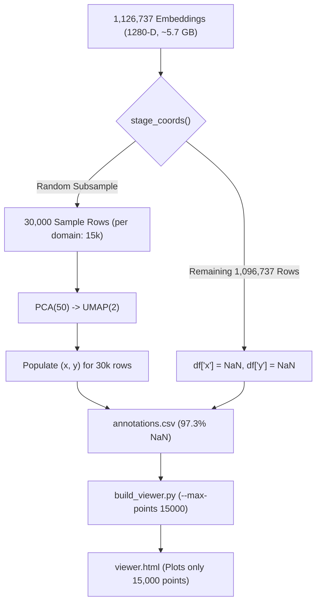
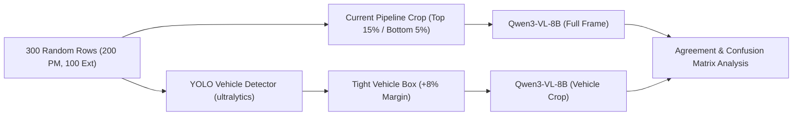

# Implementation Plan: Resolving E-01, E-02 & Root Cause for E-03

## Goal Description
This plan addresses the three core data and pipeline defects identified in [errors.md](../errors.md):
1. **E-03 Analysis**: Provide a definitive root-cause explanation for why 97.3% of UMAP coordinates in Run 5 are `NaN`.
2. **E-01 Implementation**: Resolve the discrepancy where External bounding boxes are hard-coded to `-1` across all 33,329 Run 4/5 samples (and all 67,695 expanded 51-make samples) while documentation claimed tight bbox cropping.
3. **E-02 Implementation**: Build and execute an automated 300-sample verification probe comparing Qwen3-VL color annotations on full-frame crops vs detector-cropped vehicles (using YOLO) to quantify background interference and determine whether re-annotation is required.

---

## User Review Required

> [!IMPORTANT]
> **E-01 Decision**: Even in historical Run 3, only Stanford Cars (4,100 out of 41,880 images = 9.8%) ever had bounding boxes; BoxCars116k and CompCars CCTV never had bboxes (`-1`). For Model C, `external_resized_512` was already YOLOv8s-cropped and letterboxed to 512x512 during dataset creation (`bbox_* = -1`), and training was done on those 512x512 images with a 5% bottom watermark crop. We adopted **Option A**: Aligning all documentation and code comments to the actual training setup.
>
> **E-02 Execution Safety**: The 300-image detector vs full-frame probe will load `yolo11n.pt` and `Qwen/Qwen3-VL-8B-Instruct` on GPU 0. It takes ~2-3 minutes to run on 300 images. We will provide a dedicated script `code/current/mobilenet/annotation/verify_crop_agreement.py` for user execution.

---

## 1. Deep Dive: Why Did E-03 Happen?

### The Discrepancy
In `annotation_runs/run5/annotations.csv`, the 2D projection columns `x` and `y` are `NaN` for **1,096,737 out of 1,126,737 rows (97.3%)**. In Run 4, they are `NaN` for **87.0%** of rows. Meanwhile, [run_docs/annotation_run_4_and_5.md](annotation_run_4_and_5.md) originally stated:
> *"Stage 2: 2-D coordinates (UMAP / t-SNE). Projects all N points into coordinates (x, y) for visualization."*

### Root Cause Analysis



1. **Compute & RAM Scalability**:
   Fitting UMAP directly on 1.12 million 1280-D vectors in memory requires ~30+ GB of working RAM and hours of CPU/GPU compute. UMAP's neighbor graph construction scales as $O(N \log N)$ or worse.
2. **Hard-coded Subsampling in `stage_coords`**:
   In [annotation/annotate.py](../annotation/annotate.py#L254-L285), `--coords-max` was set to `30000` (15,000 per domain). The script sampled 30,000 rows, computed PCA + UMAP on them, and directly assigned:
   ```python
   df["x"] = np.nan; df["y"] = np.nan
   df.loc[chosen, "x"] = xy[:, 0]
   df.loc[chosen, "y"] = xy[:, 1]
   ```
3. **Missing Out-of-Sample Transform**:
   UMAP supports `umap_model.transform(new_data)`. The author could have fitted UMAP on the 30k landmark sample and called `transform()` in batches on the remaining 1.09M points. However, this was skipped because:
4. **Viewer Only Displays $\le$ 30,000 Points**:
   WebGL in Plotly crashes or stutters heavily in web browsers when rendering $>30,000$ points. [annotation/build_viewer.py](../annotation/build_viewer.py) drops rows where `x` is `NaN` and samples up to `max_points=15000`. The author only cared that the HTML viewer had enough points to render a scatter plot.
5. **Documentation Drift**:
   The documentation in `annotation_run_4_and_5.md` was written describing the conceptual intent rather than the implementation detail, failing to note that 97.3% of rows are intentionally left as `NaN`.

---

## 2. Implementation Plan: E-01 (External Bounding Boxes)

### Background & Evidence
- In [merged_dataset/splits_1235models/all_splits.csv](../merged_dataset/splits_1235models/all_splits.csv), `bbox_x1`, `bbox_y1`, `bbox_x2`, `bbox_y2` are `-1` on **100% of rows** (`33,329` rows in the Run 4/5 35-make split, and `67,695` rows in the expanded 51-make split).
- Investigation of the source files shows:
  - In Run 3 (`backup_run3`), only Stanford Cars (4,100 images, ~9.8% of External) had manifest bboxes (`bbox_x1 >= 0`). BoxCars116k (18k) and CompCars CCTV (19.6k) were **always** `-1`.
  - For Run 4 and later, images were read from `$ECON_ROOT/external_resized_512/external_metadata_51make.csv`, where `$ECON_ROOT/scripts/rebuild_external_resized_512.py` had already YOLOv8s-cropped and letterboxed the vehicles to 512×512 during dataset creation. Because the stored 512×512 images are already cropped, the split CSVs store `bbox_* = -1`.
  - Model C (`train_mobilenet_v2_merged.py`) therefore trains on the 512×512 images with `ext_crop_bottom_pct = 0.05` (5% bottom crop).

### Proposed Actions for E-01 (Completed)
1. **Document Ground Truth in Code & Reports**:
   - Updated [run_docs/run_4.md](run_4.md): Explicitly states that Model C trains on 512x512 images with top 15% crop for PlatesMania and bottom 5% crop for External (`bbox_* = -1`).
   - Clarified in [annotation/common.py](../annotation/common.py) docstring that `bbox_* = -1` in current 512x512 splits.
   - Updated [README.md](../README.md) and [run_docs/annotation_run_4_and_5.md](annotation_run_4_and_5.md).
2. **Audit Model B vs Model C Comparability**:
   - Recorded in `run_4.md` that Model B had manifest bboxes on 9.8% of images (Stanford Cars only), whereas Model C used `external_resized_512` (`bbox = -1`).

---

## 3. Implementation Plan: E-02 (Qwen Full-Frame vs Crop Agreement Probe)

### Objective
Quantify whether Qwen3-VL-8B's color predictions change when given a tight bounding box crop of the vehicle vs the full-frame crop (top 15% or bottom 5% removed).

### Proposed Script: `verify_crop_agreement.py`
Create [annotation/verify_crop_agreement.py](../annotation/verify_crop_agreement.py) with the following workflow:



#### Detailed Logic:
1. **Stratified Sampling**:
   Draw 300 images from `annotation_runs/run5/annotations.csv`:
   - 200 PlatesMania images, 100 External images.
   - Stratified across colors and across high/low Qwen confidence (including conf < 0.70).
2. **Automated Vehicle Detection**:
   - Use `ultralytics.YOLO("yolov8n.pt")` or `yolo11n.pt` (auto-downloaded by ultralytics to `~/.cache`).
   - Filter for vehicle classes: `car`, `truck`, `bus`.
   - Take the largest detected vehicle bounding box; expand by 8% margin so car contours are preserved.
   - If no vehicle detected (rare), fallback to center 75% crop.
3. **Dual Qwen Inference**:
   - Feed both image versions to `Qwen3VLColorHead` with the identical prompt and options.
4. **Metrics Reported**:
   - Overall Agreement Rate: $\frac{\text{matching colors}}{300}$.
   - Per-domain agreement (PlatesMania vs External).
   - High-confidence ($\ge 0.70$) vs low-confidence agreement.
   - Confusion pairs (e.g. Full-frame `gray` $\to$ Vehicle `blue`).
   - Summary report saved to `code/current/mobilenet/run_docs/crop_agreement_study.md`.

---

## Proposed Changes Grouped by File

### Documentation & Alignment
#### [MODIFY] [run_docs/run_4.md](run_4.md)
- Clarify crop definitions: PlatesMania (top 15% crop), External (bottom 5% crop, `bbox_* = -1` in 512x512 dataset).
- Record comparability notes with Model B.

#### [MODIFY] [annotation/common.py](../annotation/common.py)
- Clarify in docstrings that `bbox` defaults to domain crop when `bbox_x1 == -1`.

#### [MODIFY] [run_docs/annotation_run_4_and_5.md](annotation_run_4_and_5.md)
- Update Stage 2 description: Explicitly state that UMAP coordinates are computed for a 30,000-sample landmark subset for web visualization, and remaining rows are `NaN`.
- Correct crop description (removes "Pre-crops vehicles to tight bounding boxes").

---

### Verification Tools
#### [NEW] [annotation/verify_crop_agreement.py](../annotation/verify_crop_agreement.py)
- Standalone verification script running the 300-image detector vs full-frame test.
- Outputs accuracy, confusion matrix, and visual samples of disagreements.

---

## Verification Plan

### Automated Verification
1. **Run E-02 Crop Agreement Script**:
   ```bash
   cd vmmr/code/current/mobilenet
   python annotation/verify_crop_agreement.py --num-samples 300 --output-report run_docs/crop_agreement_study.md
   ```
2. **Inspect Disagreement Threshold**:
   - If agreement $\ge 90\%$, confirm that full-frame annotation is acceptable and documented.
   - If agreement $< 90\%$, quantify error patterns to inform E-08 retrained color heads.
3. **Verify Data Integrity**:
   - Check that `all_splits.csv` and `annotations.csv` remain intact.
