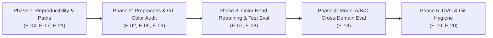

# Master Implementation Plan: Resolving All Items (`E-01` – `E-21`) in `errors.md`

## Goal Description
[`errors.md`](../errors.md) catalogs 21 issues across four sections:
- **Section A (`E-01` – `E-10`)**: Data, cropping, UMAP, feature extraction, color head training/evaluation, and ground-truth validation defects.
- **Section B (`E-11` – `E-16`)**: Documentation collisions and path configuration mismatches *(all 6 resolved in the previous step)*.
- **Section C (`E-17` – `E-18`)**: Process reproducibility (`run_config.json`) and like-for-like Model A/B/C cross-domain benchmarks.
- **Section D (`E-19` – `E-21`)**: Repository, DVC, and `.gitignore` hygiene.

This plan maps the current status of all 21 items and defines a **5-phase execution plan** to implement every remaining fix in code, data, benchmarks, and DVC tracking.

---

## Status Matrix of All 21 Items in `errors.md`

| ID | Priority | Summary | Status | Execution Phase |
| :--- | :---: | :--- | :---: | :--- |
| **E-01** | P0 | External `bbox_*` audit & `BoxCars116k` `2DBB` fix | **DONE** | Verified all 5 External sources + populated `18,520` `BoxCars116k` `2DBB` bboxes |
| **E-02** | P0 | Qwen full-frame vs YOLO vehicle crop agreement (300 rows) | **OPEN** | **Phase 2** (`verify_crop_agreement.py` — note: PM & 4/5 Ext sources already cropped) |
| **E-03** | P0 | UMAP coordinates `NaN` for 97.3% of Run 5 | **DONE** | Completed in Docs *(optional full transform in Phase 2)* |
| **E-04** | P1 | Relative paths in split & annotation CSVs + common resolver | **OPEN** | **Phase 1** (`annotation/common.py` + CSVs) |
| **E-05** | P1 | `train_color_head.py` `Image.BILINEAR` vs antialiased resize | **OPEN** | **Phase 2** (2,000-image check + dataset unification) |
| **E-06** | P0 | Verify bit-for-bit identity of `mobilenet_v2_multitask.onnx` | **DONE** | Verified (`0.000e+00` diff on 256 images) |
| **E-07** | P1 | Unbiased color head evaluation on `test` split (all vs $\ge 0.70$) | **OPEN** | **Phase 3** (`train_color_head.py`) |
| **E-08** | P0 | Retrain color head without class-weight handicap + `512x2` / spatial tap | **OPEN** | **Phase 3** (`train_color_head.py` ablations) |
| **E-09** | P0 | Validate Qwen3-VL & distilled head against human color labels | **OPEN** | **Phase 2 & 3** (19,479 CompCars GT rows + review CSV) |
| **E-10** | P1 | Production camera domain shift (night/IR) | **DEFERRED** | Awaits production camera frames (documented) |
| **E-11** | P1 | Fix `annotation_run_4_and_5.md` errors | **DONE** | Completed |
| **E-12** | P1 | Fix `dvc_gdrive_guide.md` & `paths.py` DVC keys | **DONE** | Completed (`paths.py --check` verified) |
| **E-13** | P1 | Update stale `README.md` | **DONE** | Completed |
| **E-14** | P1 | Fix `bash_scripts/commands.md` `RUN_NAME` / `MODEL_RUN` | **DONE** | Completed |
| **E-15** | P1 | Fix `run_docs/run_4.md` crop notes | **DONE** | Completed (A/B re-eval in **Phase 4**) |
| **E-16** | P2 | Sync `CLAUDE.md` layout on Research PC | **DONE** | Completed |
| **E-17** | P0 | Write `run_config.json` in all trainers/annotators + backfill | **OPEN** | **Phase 1** (`train_common.py`, `annotate.py`, `train_color_head.py`) |
| **E-18** | P0 | Re-evaluate Models A & B on new External test split + shared-class PM | **OPEN** | **Phase 4** (`evaluate_mixed.py`) |
| **E-19** | P1 | Move remaining Git-tracked `.onnx` models & `run4` to DVC | **OPEN** | **Phase 5** (`git rm --cached` + `dvc.sh add`) |
| **E-20** | P2 | Clean up `.gitignore` duplicates & protect `auto_git_sync.sh` | **OPEN** | **Phase 5** (`.gitignore` + `auto_git_sync.sh`) |
| **E-21** | P2 | Rename `checkpoint_path` $\to$ `model_path` in `MobileNetV2Evaluator` | **PARTIAL** | **Phase 1** (`output_analysis.py`) |

---

## Key Research Discovery for `E-09` (Free Human Ground-Truth Color Dataset!)

> [!TIP]
> **19,479 Human-Labeled CompCars Color Ground-Truth Annotations Already Match Run 5!**
> During our inspection of `compcars_cctv/extracted/sv_data_extracted/sv_data/color_list.mat` and `external_resized_512/external_metadata_51make.csv`, we discovered that `external_metadata_51make.csv` already carries a `color_label` column (`0..9`, mapped from CompCars `color_list.mat`) for **33,310 CompCars CCTV images**, and **19,479 of those rows are present in `annotation_runs/run5/annotations.csv`**!
> - **CompCars 10-Color Schema**: `0: black`, `1: white`, `2: red`, `3: yellow`, `4: blue`, `5: green`, `6: purple`, `7: brown`, `8: champagne`, `9: silver` *(note: CompCars groups gray and silver together under `9: silver`, and champagne under `8: champagne`)*.
> - **Preliminary Check on all 19,479 rows**: Qwen3-VL-8B achieves **70.55%** strict 10-class agreement (which penalizes Qwen whenever it predicts `gray` on a CompCars `9=silver` vehicle) and **78.85%** agreement when `silver`/`gray` and `champagne`/`beige`/`gold` are aligned!
> - We can use this **19,479-image human-labeled subset** (plus a stratified 600-image PlatesMania/External review sheet) to benchmark both **Qwen3-VL-8B** and every **distilled MobileNetV2 color head (`E-08`)** against true human labels!

---

## Open Decisions for User Review

> [!IMPORTANT]
> **1. GPU Execution for `E-02` (300-image YOLO + Qwen3-VL Probe) and `E-08` / `E-18`**:
> - **Phase 1**, **Phase 3** (retraining the color head on cached features + evaluating `test`), **Phase 4** (re-evaluating Models A and B on the External test split), and **Phase 5** (DVC & `.gitignore` hygiene) are lightweight and can be executed directly or via short benchmark runs.
> - For **`E-02`** (loading `Qwen3-VL-8B` + `yolov8n.pt` on 300 images, ~3 mins on GPU), should we run it directly during execution if the GPU is free, or provide the ready-to-run command for you to launch in `tmux`?
>
> **2. `E-19` DVC Migration Scope**:
> Git currently tracks **12 `.onnx` files** (~165 MB total across `merged_dataset/output_merged_run4`, `backup_run1`, `backup_run3`, and `code/current/efficientnet`) plus `annotation_runs/run4/{annotations.csv,viewer.html}` (50 MB). Moving all of them to DVC (`git rm --cached` + `./bash_scripts/dvc.sh add`) will keep the Git working tree light while preserving every file on disk and in Google Drive. Confirm if you want all 12 `.onnx` files and `annotation_runs/run4` migrated to DVC, or only the `backup_run*` and `efficientnet` ones.

---

## Proposed Changes by Phase



---

### Phase 1: Reproducibility, Relative Paths & API Cleanup (`E-04`, `E-17`, `E-21`)

#### [MODIFY] [`annotation/common.py`](../annotation/common.py) (`E-04`)
- Add portable path helpers used across `prepare_external_1235models.py`, `annotate.py`, `build_viewer.py`, and `train_color_head.py`:
  ```python
  def to_rel_image_path(raw_path: str, domain: str) -> str:
      """Strip machine-specific PM_IMG_DIR or EXT_DATASETS_DIR prefix so CSVs store portable relative paths."""
      ...

  def resolve_image_path(stored_path: str, domain: str) -> str:
      """Resolve either a portable relative path or legacy absolute path against current paths.py roots."""
      ...
  ```
- Convert `merged_dataset/splits_1235models/{train,val,test,all_splits}.csv` `image_path` column to relative paths (e.g. `images/Acura/acura_stanford_cars_00004.jpg`), and update `ExternalMergedDataset` in `train_common.py`, `output_analysis.py`, and `evaluate_mixed.py` to join `paths.EXT_DATASETS_DIR` when `image_path` is relative.

#### [MODIFY] [`train_common.py`](../train_common.py) (`E-17`)
- Add `save_run_config(output_dir: Path, args: Any, script_name: str, extra: Optional[dict] = None) -> Path`:
  - Records `argv`, `resolved_args`, `git_commit` (`git rev-parse HEAD`), `git_dirty`, `hostname`, `user`, `python_version`, `torch_version`, `onnxruntime_version`, `cuda_device_name`, `seed`, `start_time_iso`, and `end_time_iso` into `<output_dir>/run_config.json`.
- Wire `save_run_config()` into:
  - [`merged_dataset/train/train_mobilenet_v2_merged.py`](../merged_dataset/train/train_mobilenet_v2_merged.py)
  - [`annotation/annotate.py`](../annotation/annotate.py)
  - [`color_distillation/train_color_head.py`](../color_distillation/train_color_head.py)
- Backfill reconstructed `run_config.json` files (clearly marked `"reconstructed": true`) into:
  - `merged_dataset/output_merged_run4/run_config.json`
  - `annotation_runs/run4/run_config.json`
  - `annotation_runs/run5/run_config.json`
  - `color_distillation/output/run_config.json`

#### [MODIFY] [`output_analysis.py`](../output_analysis.py) (`E-21`)
- Update `MobileNetV2Evaluator.__init__(self, num_classes: int, model_path: Optional[str] = None, checkpoint_path: Optional[str] = None)` so `model_path` is the primary parameter name while `checkpoint_path` remains supported as a backward-compatible keyword alias.

---

### Phase 2: Preprocessing Verification, Crop Probe & Ground-Truth Color Audit (`E-02`, `E-05`, `E-09`)

#### [NEW] [`color_distillation/verify_preprocessing_e05.py`](../color_distillation/train_color_head.py) (`E-05`)
- Runs 2,000 validation images through:
  1. Legacy `ImageExtractDataset` (`PIL.Image.BILINEAR` without antialias), and
  2. `output_analysis.DiagnosticDataset` (`torchvision.io.read_image` + antialiased `F.interpolate`),
  extracts `features[16]` from both, and computes the relative $L_2$ and max absolute difference (`||f_a - f_b|| / ||f_b||`) and downstream MLP prediction agreement.
- Updates `train_color_head.py` (`ImageExtractDataset`) to use `DiagnosticDataset`'s exact antialiased bilinear resize convention (`CLAUDE.md` rule).

#### [NEW] [`color_distillation/evaluate_compcars_color_gt.py`](../color_distillation/train_color_head.py) (`E-09`)
- Joins `annotation_runs/run5/annotations.csv` against the **19,479 human-labeled CompCars CCTV rows** in `external_metadata_51make.csv` (`color_label 0..9`).
- Evaluates:
  1. **Qwen3-VL-8B pseudo-labels** vs. CompCars human ground truth (overall, by `color_conf >= 0.70` vs `< 0.70`, and per-color confusion matrix), and
  2. **Distilled MobileNetV2 color heads** vs. CompCars human ground truth on the held-out `test` split.
- Also generates a stratified 600-image human review CSV/HTML sample (`annotation_runs/color_human_review_600.csv`) across both PlatesMania and External (including `color_conf < 0.70` rows) for manual spot-checking.
- Writes a comprehensive report to `run_docs/color_ground_truth_validation.md`.

#### [NEW] [`annotation/verify_crop_agreement.py`](../annotation/annotate.py) (`E-02`)
- Samples 300 stratified rows (200 PlatesMania, 100 External) from `annotation_runs/run5/annotations.csv`.
- Runs a pretrained YOLO detector (`yolov8n.pt` / `yolo11n.pt`) to obtain tight vehicle bounding boxes (+8% margin) and compares Qwen3-VL-8B color predictions on full-frame domain crops vs. tight vehicle crops.
- Saves agreement metrics and confusion pairs to `run_docs/crop_agreement_study.md`.

---

### Phase 3: Unbiased Test Evaluation & Color Head Architecture/Loss Ablations (`E-07`, `E-08`)

#### [MODIFY] [`color_distillation/train_color_head.py`](../color_distillation/train_color_head.py) (`E-07`, `E-08`)
1. **Unbiased Split & Confidence Handling (`E-07`)**:
   - Extract and cache `test` features (`features_L16_test.npy`, `labels_test.npy`, `conf_test.npy`) alongside `train` and `val` (`conf_train.npy`, `conf_val.npy`).
   - Do **not** drop `color_conf < 0.70` rows when caching `val` and `test` features; apply `--min-conf` filtering on `train` (for training label quality) and report validation/test metrics separately on:
     - **All `test` rows** (100% coverage, including `color_conf < 0.70`),
     - **High-confidence `test` rows** (`color_conf >= 0.70`), and
     - **CompCars Human Ground-Truth `test` rows**.
   - Select the best epoch on `val` macro F1 / accuracy, and report final headline numbers from the untouched **`test`** split.
2. **Loss & Architecture Improvements (`E-08`)**:
   - Add CLI flags (all defaulting to original behavior per `CLAUDE.md`):
     - `--no-class-weights`: Disables the `[0.25, 4.0]` inverse-frequency class weights that wrecked precision on `green` (`28%`), `brown` (`27%`), and `beige` (`21%`).
     - `--arch {mlp_128,mlp_512x2,mlp_512x3,linear}`: Supports 2-layer `512 -> 512 -> 13` and 3-layer `512 -> 512 -> 512 -> 13` residual/MLP heads with BatchNorm folding for ONNX export.
     - `--spatial-pool {1,4}`: Supports $4\times4$ adaptive average pooling on `features[16]` ($160 \times 4 \times 4 = 2,560$-D input, preserving vertical hood/roof/road spatial layout instead of collapsing the $16\times16$ grid to $1\times1$).
3. **Run Ablation Matrix & Update Report**:
   - Train and evaluate on the server:
     1. **Baseline (Shipped)**: `mlp_128`, class weights ON, `label_smoothing=0.05`, `1x1` pool.
     2. **Ablation 1 (Unweighted CE)**: `mlp_128`, `--no-class-weights --label-smoothing 0.0`.
     3. **Ablation 2 (Wide 2-Layer MLP)**: `mlp_512x2`, `--no-class-weights --label-smoothing 0.0`.
     4. **Ablation 3 (Spatial 4×4 Pool + 512×2 MLP)**: `--spatial-pool 4 --arch mlp_512x2 --no-class-weights --label-smoothing 0.0`.
   - Record all `val`, `test (all)`, `test (conf >= 0.70)`, and `CompCars Human GT` accuracy & Macro F1 numbers in [`run_docs/color_distillation_report.md`](color_distillation_report.md).

---

### Phase 4: Open Cross-Domain Benchmarks for Run 4 (`E-18`)

#### [MODIFY] [`evaluate_mixed.py`](../evaluate_mixed.py) & [`run_docs/run_4.md`](run_4.md) (`E-18`)
- Run `evaluate_mixed.py` to compare **Model A** (`backup_run3/platesmania_dataset/output_mobilenet_v2/models/mobilenet_v2_best.onnx`) and **Model B** (`backup_run3/external_dataset/output_mobilenet_v2_external/models/mobilenet_v2_best.onnx`) on the regenerated External test split (restricted to the 1,235 base classes so A, B, and C are evaluated on the exact same images and taxonomy).
- Compute **Model A's** accuracy on the PlatesMania test split restricted to the shared External classes (`286` Run 4 shared classes and `290` updated shared classes), answering whether Model C's `94.3%` (`96.9%` restricted) shared-class accuracy on PlatesMania beats Model A on those exact same classes.
- Append the complete like-for-like comparison table to Section 2 and Section 5 of [`run_docs/run_4.md`](run_4.md).

---

### Phase 5: Repository, DVC & `.gitignore` Hygiene (`E-19`, `E-20`)

#### [MODIFY] [`.gitignore`](../../../../.gitignore) & [`bash_scripts/lib/auto_git_sync.sh`](../bash_scripts/lib/auto_git_sync.sh) (`E-19`, `E-20`)
1. **Clean up `.gitignore` (`E-20`)**:
   - Remove duplicate `/archive` vs `/archive/` lines, organize rules by category, keep `*plotly.min.js` and `*__pycache__` ignored, and add safety rules (`*.onnx`, `**/annotation_runs/*/*.csv`, `**/annotation_runs/*/*.html`, `**/annotation_runs/*/*.npy`) so `auto_git_sync.sh` (`git add -A code/current/mobilenet/`) can never accidentally stage large binaries into Git.
2. **Migrate Legacy Git-Tracked Binaries to DVC (`E-19`)**:
   - Untrack from Git (`git rm --cached`) and track via DVC (`./bash_scripts/dvc.sh add`):
     - `code/current/mobilenet/backup_run1` ONNX models
     - `code/current/mobilenet/backup_run3` ONNX models
     - `code/current/mobilenet/merged_dataset/output_merged_run4/models/mobilenet_v2_best.onnx`
     - `code/current/mobilenet/annotation_runs/run4`
     - `code/current/efficientnet` ONNX models
