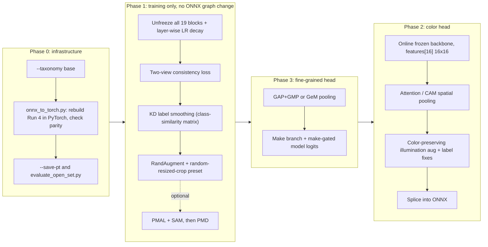

# Run 5 — Model C upgrade plan: zero-overhead training, spatial color head, fine-grained make/model head

## Goal

Improve **Model C** (merged PlatesMania + External, the production multitask base) in three phases. Every new option is a flag that defaults to the current behaviour, and the ONNX output contract stays the same:

| Output | Shape | Changed by |
|---|---|---|
| `predictions` | `B×1235` | Phase 3b (make-gated logits; same shape) |
| `embeddings` | `B×1280` | Phase 3a (GAP+GMP/GeM pooled; same shape) |
| `class_maps` | `B×1235×16×16` | unchanged formula `conv(features[18], W_cls)` |
| `color_predictions` | `B×13` | Phase 2 (spatially pooled color head) |

### Grounding facts from the codebase

| Fact | Source | Effect on the plan |
|---|---|---|
| Run 4 = `unfreeze_layers=5` (only `features[14:19]` trainable), strong aug, LS 0.1, make-loss 0.3, EMA 0.999 | `output_merged_run4/run_config.json` | This is the Run 5 baseline recipe |
| ~25 min/epoch (~875k samples/epoch, ~576 img/s); val loss still falling at epoch 15 (0.3021 → 0.3010) | `training.log`, `training_history.csv` | Long runs are fine. More epochs may also help on their own |
| **`splits_1235models/` regenerated Oct 26 → 1,416 classes**; 22,651 / 47,805 External train rows have label ≥ 1235 | `label_map.json`, CSVs | Running the trainer now would switch to 1,416 classes on its own. We need a `--taxonomy base` flag and a **re-baseline** run |
| Run 4 ONNX has BN folded (53 Conv, no BN nodes), and `features[16]` is exposed as `/features/features.16/Add_output_0` | ONNX graph inspection | A PyTorch copy of Run 4 can be rebuilt from the ONNX |
| Shipped color head (`output/`) = GAP(`features[16]`) → standardization → MLP-128 with class weights, LS 0.05: **68.0%** val | `color_distillation/output/` | Outdated, **not** the Phase 2 baseline |
| **Phase 3 color ablations (E-08):** removing class weights → MLP-128 73.2% test. **Unweighted MLP-512×2, LS 0: 75.53% test top-1 (conf ≥ 0.7), 74.31% all rows, macro-F1 62.89%, CompCars human-GT 77.43% vs Qwen teacher 78.44%** | `output_mlp512x2/`, `run_docs/color_distillation_report.md` | **Adopted as the reference production color head.** The head is already at 98.7% of the teacher on human GT with <0.04 ms latency overhead |
| E-08 "Ablation 3" (spatial 4×4 pool + 512×2) was planned but **never run** | `errors_master_implementation_plan.md` | It's the cheapest spatial test, so it runs first in Phase 2 |
| **Qwen vs CompCars human GT: 70.2% strict / 78.4% grouped.** Qwen labels most human-silver as gray (28%), and most human-brown and human-champagne as other colors (≈5–11% correct) | `color_ground_truth_validation.md` | The 68% was capped by teacher noise. We report three metrics and optimize on the human-GT-aligned one |
| 87% of color labels have `color_conf = 1.0` | run5 `annotations.csv` | Weighting by confidence alone does almost nothing. Fixing the labels does more |
| Color labels exist for **all** 898k train rows | run5 | The spatial color head can train end-to-end on images |
| No viewpoint/3D-box columns in the External splits; PlatesMania has no pose labels | splits CSVs | The auxiliary pose head is deferred (see end) |

---

## User Review Required

> [!IMPORTANT]
> **Re-baseline is required.** The External splits changed after Run 4: twice as many External train rows, plus new classes. Run 4's numbers are therefore not a valid control. Run **R5-0** repeats the Run 4 recipe on the current data with `--taxonomy base` (1,235 classes). Every Run 5 variant is compared with R5-0, not with Run 4.

> [!IMPORTANT]
> **Open-set rejection is a production requirement.** So: **no Mixup/CutMix** anywhere. A new `evaluate_open_set.py` uses the 181 external-only classes (label 1235–1415, 4,740 test images, never seen with `--taxonomy base`) as the "unknown" set. It scores MSP / MLS / Energy / embedding-cosine and reports AUROC, FPR@95 and OSCR. A technique that improves closed-set accuracy but hurts AUROC by more than 1 pt gets flagged.

> [!WARNING]
> **Changing the backbone invalidates the color head.** Any Phase 1 change to `features[0:17]` changes the `features[16]` activations, so the color head must be retrained on the final Run 5 backbone. Phase 2 is prototyped on the reconstructed Run 4 backbone while Phase 1 trains, then re-run on the Run 5 winner.

> [!WARNING]
> **GAP+GMP changes how `class_maps` relates to the logits.** With pure GAP, `logit_c = mean(class_maps_c) + b_c` exactly. With GAP+GMP that identity no longer holds. `class_maps` still shows per-class spatial evidence (Grad-CAM in `output_analysis.py` keeps working), but it is no longer an exact decomposition of the logit.

> [!CAUTION]
> **New `.pt` checkpoints** (`mobilenet_v2_best.pt`, state_dict only) go next to each best ONNX, behind `--save-pt`. Add `*.pt` handling to `auto_git_sync.sh`'s DVC discovery so they never go into Git. `color_head_best.pt` is already a precedent.

---

## Open Questions

1. **Epoch count:** keep 15 epochs for every variant so the comparison is clean? Or allow the final combined run to go to 20–25 epochs, since val loss had not plateaued?
2. **CompCars human color labels as training data:** OK to replace Qwen labels with human labels on the 13,753 matched **train** rows (`--use-compcars-gt`), using the unambiguous mapping in Phase 2? The val/test human labels stay held out, so the human-GT metric stays unbiased.
3. **KD label-smoothing teacher:** start with the reconstructed **Run 4** model, available right away? Or wait for R5-0?

*(Note: `color_distillation/output_mlp512x2/mobilenet_v2_multitask.onnx` [Deep MLP-512×2] is officially documented as the reference production color head).*

---

## Architecture overview



Phase 3 changes the classifier and is trained together with the Phase 1 recipe. Phase 2 runs last, on the frozen final backbone.

---

## Proposed Changes

### Component 0 — Infrastructure (`code/current/mobilenet/`)

#### [MODIFY] `merged_dataset/train/train_mobilenet_v2_merged.py`
- `--taxonomy {auto,base}` (default `auto` = current behaviour). `base` keeps the PlatesMania 1,235-class map and drops External rows with `label >= 1235` from train/val/test. The count of dropped rows is logged.
- `--save-pt`: saves `models/mobilenet_v2_best.pt` (state_dict of the EMA/eval model plus a `model_cfg` dict) at each new best checkpoint.
- The training step moves into a `train_step()` helper so the consistency, distillation, SAM and PMAL branches stay readable. With no new flags, the old step runs unchanged.
- The test-split evaluation at the end also reports make accuracy (marginalization), so phases can be compared without running diagnostics.

#### [NEW] `onnx_to_torch.py`
Rebuilds a torchvision `mobilenet_v2` from a BN-folded ONNX file:
- Walks ONNX `Conv` nodes in order, maps them to torchvision `Conv2d` modules in order (53 ↔ 53), and copies `W` and `b`. Each `BatchNorm2d` is set to identity (`γ=1, β=0, μ=0, σ²=1−eps`).
- **Parity check:** max |Δlogits| and |Δembeddings| against ORT on 64 real images must be < 1e-3, otherwise the script exits with an error.
- Used for: the KD-LS / distillation teacher, Phase 2 prototyping on Run 4, and optionally a warm start for Run 5.

#### [NEW] `evaluate_open_set.py`
- Known set = PlatesMania test + External test with `label < 1235`. Unknown set = External test with `label ≥ 1235`.
- Scores: MSP, MLS (max logit), Energy (`−logsumexp`), and cosine to class-mean embeddings (means built from train embeddings).
- Metrics: AUROC, FPR@95TPR, OSCR, closed-set accuracy. Writes `open_set_metrics.json` plus a score-histogram PNG. Runs on any ONNX, so it also runs on Run 4 for reference.

---

### Component 1 — Phase 1: training-only upgrades (no ONNX graph change)

#### [NEW] `regularizers.py` (imported by the trainer; keeps `train_common.py` small)

**1a. Full unfreeze + layer-wise LR decay**

`--unfreeze-layers 19` already works with `create_model` (`len(features)==19`), so `set_train_mode` stops freezing BN. New flags:
- `--layer-lr-decay γ` (default 1.0 = current behaviour): block `i` gets `backbone_lr · γ^(18−i)`, so shallow blocks get small updates and the ImageNet low-level filters don't drift.
- `--freeze-bn-stats` (default off): keeps BN running stats of `features[0:14]` frozen even while their weights train. This is a safety valve for small per-domain batch statistics.

**1b. Consistency regularization** — `--consistency-weight λ` (default 0), `--consistency-type {js,kl}`, `--consistency-temp T`

```python
x1, x2 = augment_batch(u8, s), augment_batch(u8, s)          # two views from one decoded batch (no extra I/O)
logits = model(torch.cat([x1, x2]))                          # one forward, BN sees both views
l1, l2 = logits.chunk(2)
loss = 0.5 * (obj(l1, y) + obj(l2, y)) + λ * js_div(l1 / T, l2 / T)   # JS = symmetric, label-free
```
Cost: about 2× GPU time per step. The data-loading cost stays the same.

**1c. Knowledge-distillation label smoothing** (Wolf et al., WACVW 2024 style) — `--kd-ls-matrix path.npy --kd-ls-alpha 0.1`

[NEW] `build_kd_smoothing_matrix.py`: runs the teacher (reconstructed Run 4, or R5-0) over the train split without augmentation and accumulates the mean `softmax(z/T)` per ground-truth class (T=4). It then zeros the diagonal, row-normalizes, and saves `S ∈ R^{1235×1235}` (6 MB). No teacher runs during training.

```python
target = (1 - α) * one_hot(y) + α * S[y]          # BMW 3 → mostly BMW 5/4, ~0 Dodge Sprinter
loss   = soft_ce(logits, target)                  # replaces uniform LS when the flag is set
```
`TrainObjective` gains soft-target support. The auxiliary make loss stays as it is.

**1d. RandAugment + random-resized crop** — `--aug-strength randaug` (a new preset; `base`/`strong` unchanged), `--randaug-n 1 --randaug-m 10 --rrc-scale 0.08 1.0`
- Applied per sample in the DataLoader workers on uint8 (`v2.RandAugment` + `v2.RandomResizedCrop`). Running it on the GPU batch would apply the same op to the whole batch. The workers then hand off to the existing flip + normalize step on the GPU.
- The 8% minimum crop is aggressive for fine-grained car crops, so it is a flag. The ablation also tests a 0.25 minimum.
- No Mixup/CutMix (open-set requirement).

**1e. Generic distillation from a teacher `.pt`** — `--teacher-pt path --kd-weight w --kd-temp T --rkd-weight r`
- Online teacher forward under `torch.no_grad()`/AMP on the same augmented batch. KL on soft logits, plus an optional relational loss on embeddings (RKD distance + angle) for the 1280-D embedding head.
- This is the shared machinery for **PMD** (below) and for any future heavy teacher. `--teacher-arch` accepts torchvision names, but training a DenseNet201+ResNet50V2 teacher is **out of scope** for this round.

**1f. (Optional, long) PMAL + SAM → PMD** — `--pmal-stages 3,6,13 --pmal-noise-std 0.1 --sam-rho 0.05`

[NEW] `pmal.py`:
- `DenoisingRecognitionHead(c_in, r)`: `Conv3×3(c_in→64)-ReLU-Conv3×3(64→3·r²)-PixelShuffle(r)` reconstructs the clean normalized image. A `GAP-Linear(c_in→1235)` auxiliary classifier is attached. Taps: `features[3]` (24ch, r=4), `features[6]` (32ch, r=8), `features[13]` (96ch, r=16).
- Per iteration, K+1 progressive steps from shallow to deep. Step k feeds the noisy input `x+N(0,σ²)` and optimizes `MSE(DRH_k, x) + CE(aux_k)`. Gradients from step k only reach `features[0:k_tap]`. The final step is the full clean CE objective (with 1a–1d).
- SAM: a custom `SAM` optimizer wrapper that works with `GradScaler` (unscale → perturb by ρ·g/‖g‖ → second forward/backward → restore → step). Cost is about 2× per step.
- **PMD:** the DRHs are training-only and are dropped at export, so the PMAL model already has the clean MobileNetV2 graph. PMD then distills it (1e, `--teacher-pt pmal_best.pt`) into a fresh student trained on clean inputs, with KL plus intermediate-feature MSE at the same taps.
- Rough cost: (K+1)·2 = 8× the per-step cost → **~2–3 days for 15 epochs**. This is the last Phase 1 experiment and only runs if 1a–1d leave room for gains.

---

### Component 3 — Phase 3: fine-grained head (trained together with Phase 1)

#### [MODIFY] `train_common.py`
New `VMMRNet(nn.Module)` wrapping the torchvision backbone. torchvision's `forward` hard-codes average pooling, so the pooling must be overridable. With `--pool gap` (default), the state_dict layout and ONNX graph are identical to today's.

**3a. Pooling** — `--pool {gap,gap_gmp,gem}`
```python
f = self.features(x)                                  # B×1280×16×16 (after ReLU6)
if pool == "gap":     e = f.mean((2,3))
if pool == "gap_gmp": e = f.mean((2,3)) + f.amax((2,3))      # stays 1280-D
if pool == "gem":     e = f.clamp_min(1e-6).pow(p).mean((2,3)).pow(1/p)   # learnable p≈3
```
> [!NOTE]
> `features[18]` ends in **ReLU6**, so GMP saturates at 6 on strongly active channels and loses information. That is why **GeM** (a smooth average↔max blend; ONNX ops Pow/ReduceMean/Pow, < 0.05 ms) is tested next to GAP+GMP. CMP is dropped because it reduces channels and would break the 1280-D embedding contract.

**3b. 2B–2S make branch + decision module** — `--make-gating {none,scalar,per_class}`
```python
make_logits  = self.make_fc(e)                        # Linear(1280 → 35)
log_pm       = F.log_softmax(make_logits, -1) @ M.T   # M: fixed 1235×35 class→make one-hot (buffer)
model_logits = self.classifier(e) + self.beta * log_pm        # beta: scalar or per-class, init 0
loss += w_make * CE(make_logits, make_y)              # dedicated make recognizer (aux)
```
- `predictions` = gated logits, still 1235-D. Make accuracy by marginalization keeps working. `class_maps` uses the base classifier weights (the gating adds a per-image constant per make).
- ONNX cost: Gemm(1280×35) + LogSoftmax + MatMul(35×1235) + Mul + Add, about 0.01–0.03 ms.
- Initializing β at 0 means training starts exactly at the ungated model.

#### [MODIFY] `OnnxExportWrapper` / `export_to_onnx`
Delegates to `VMMRNet.forward_export()` → `(predictions, embeddings, class_maps)` with unchanged names and dynamic axes. With default flags, the exported graph is checked to have the same op counts as Run 4 (Conv 53, Clip 35, GAP 1, Gemm 1).

---

### Component 2 — Phase 2: spatially pooled color head

> [!IMPORTANT]
> **Baseline = the E-08 Ablation 2 head** (unweighted Deep MLP-512×2, LS 0.0): 75.53% / macro-F1 62.89% on Qwen test, 77.43% on CompCars human GT (teacher: 78.44%). Every Phase 2 head defaults to **no class weights, LS 0, MLP-512×2**. The weighted MLP-128 (68%) is no longer a reference.
>
> **Implication:** against human GT, the student is already within 1 pt of its teacher. Better pooling mostly improves agreement with Qwen. To go *past* the teacher on human GT we need **cleaner labels**, so the label-quality items below rank above the pooling variants for the human-GT metric.

**Step 2a — cheap cached ablations (minutes each, extends `train_color_head.py`, no online training):**
- `--spatial-pool 4` (E-08 Ablation 3, never run): adaptive-avg-pool `features[16]` to 4×4 → 2,560-D → MLP-512×2. Cache: 875k × 2,560 × fp16 ≈ **4.5 GB** (not the 70 GB of a full 16×16 cache).
- `--cam-pool`: a zero-parameter foreground-weighted pool. `softmax(ReLU(class_maps[top1])/τ)` is computed once during extraction and gives a 160-D cache. This tests the masking hypothesis before any learned attention.
- Both export to ONNX with existing ops (AveragePool/Reshape, or Softmax/Mul/ReduceSum).

**Step 2b — online trainer, only if 2a shows spatial pooling helps.**

#### [NEW] `color_distillation/train_color_head_spatial.py`
A full 16×16 cache isn't practical (~70 GB), so this script trains **online**:
- Loads the backbone from `.pt` (Run 5) or via `onnx_to_torch.py` (Run 4 prototype), **frozen, eval, AMP**. It computes `features[16]` (B×160×16×16) and, for `cam` mode, `class_maps`. Expected throughput: ~15–25 min/epoch, limited by data loading.
- **Pooling** `--color-pool {gap,attn,cam,attn_gap}`:
  - `gap`: reproduces the E-08 Ablation 2 head (sanity check: about 75.5% on Qwen test conf ≥ 0.7, 77.4% on human GT).
  - `attn`: `Conv1×1(160→32)-ReLU-Conv1×1(32→1)` → spatial softmax over 256 cells (learnable temperature) → weighted sum of `features[16]`. About 5k params.
  - `cam`: zero-parameter foreground mask `softmax(ReLU(class_maps[top1]) / τ)` taken from the existing `class_maps` output.
  - `attn_gap`: concat `[attn_pool, gap]` → 320-D, which keeps some global context.
- Input standardization becomes a `BatchNorm1d`, folded into the first Gemm at export (same as today's `_fuse_linear_bn`).
- **Color-preserving illumination augmentation** `--color-aug {none,illum}`: hflip, mild crop, global brightness/gamma (including a low-light simulation: gamma 1.5–3, then sensor noise), contrast, mild blur. Optional white-balance jitter of ±10% teaches invariance to illuminant color (sodium lamps). **No hue, saturation, grayscale or erasing.** The Phase 1 strong/randaug color ops are never applied to this branch.
- **Label quality** (aimed at the human-GT metric):
  - `--use-compcars-gt` (13,753 train rows): human color replaces Qwen's where the mapping is unambiguous (black/white/red/blue/green/yellow/brown/silver; purple→other; champagne→beige).
  - `--conf-weighting` (loss × `color_conf^k`) and `--min-conf`, kept for completeness. Expected effect is small (see the facts table).
  - `--soft-silver-gray ε`: puts ε of the target mass on the confusable sibling (silver↔gray, beige↔gold, black↔dark blue is not a class), because Qwen itself is inconsistent there.
- **Evaluation** (all reported; checkpoints selected on the **human-GT val** macro-F1 when available, otherwise Qwen val macro-F1):
  1. Qwen-label test (all rows, and conf ≥ 0.7): top-1 / top-3 / macro-F1
  2. Grouped-taxonomy accuracy (`{silver,gray}`, `{beige,gold}`, `{yellow,orange}`)
  3. CompCars human-GT test (2,867 rows), strict and grouped
- **Export:** a new `export_spatial_color_onnx()` splices nodes onto the Run 5 ONNX. The `features[16]` tensor is found by suffix match on `features.16/Add_output_0`, so the exported name can change without breaking it. The `attn` pooling adds `Conv, Conv, Relu, Reshape, Softmax, Mul, ReduceSum`. The output name `color_predictions` (B×13) is unchanged.

Not doing: LIME / reflectance decomposition. These need extra ONNX preprocessing (or a second network) and conflict with the "< 0.05 ms" goal. Augmentation gets most of the benefit.

#### [MODIFY] `color_distillation/verify_multitask_onnx.py`
Gets a `--spatial-head` path so that ORT outputs are checked against the PyTorch head on real images. The existing latency benchmark (GPU + CPU) is reused.

---

### Runners & docs

#### [NEW] `bash_scripts/run_run5_ablations.sh`
A sequential tmux queue of `RUN_NAME=run5_<id> bash run_train_merged.sh <flags>`. Each run is followed by `evaluate_open_set.py` and `run_diagnostics.sh`. Runs can be selected (`--only R5-2,R5-3`). `run_train_merged.sh` already passes extra flags last, so overrides like `--unfreeze-layers 19` take effect.

#### [NEW] `run_docs/run_5.md`
Results table plus decisions. Also updates CLAUDE.md-style notes in `README.md` (new flags, the `.pt` policy).

### Experiment matrix (each 15 epochs, `--taxonomy base`, R5-0 recipe + listed changes)

| ID | Changes over previous | Est. time |
|---|---|---|
| R5-0 | Run 4 recipe on current data (control) | ~6.5 h |
| R5-1 | `--unfreeze-layers 19 --layer-lr-decay 0.85` | ~10 h |
| R5-2 | R5-1 + `--consistency-weight 1.0 --consistency-type js` | ~18 h |
| R5-3 | R5-2 + `--kd-ls-matrix S_run4.npy --kd-ls-alpha 0.1` (replaces uniform LS) | ~18 h |
| R5-4 | R5-3 with `--aug-strength randaug` (rrc 0.08 vs 0.25) | ~18 h each |
| R5-5 | best-so-far + `--pool gem` vs `gap_gmp` | ~18 h each |
| R5-6 | R5-5 + `--make-gating per_class` | ~18 h |
| R5-7 *(optional)* | best + PMAL+SAM → PMD | ~2–3 days |
| C5-a | Cached ablations on Run 4 features: `--spatial-pool 4` and `--cam-pool` vs the 512×2 baseline | ~1 h total (plus ~1.5 h extraction) |
| C5-b | Label fixes on the best C5-a head: `--use-compcars-gt`, `--soft-silver-gray` | minutes |
| C5-* | Online spatial head (`attn`/`attn_gap`) × illumination aug, only if C5-a shows a gain; repeated on the final Run 5 backbone | ~3–5 h each |

A technique is kept only if it beats its predecessor on the **mean of the PM + EXT val loss** (the existing selection rule) without hurting open-set AUROC by more than 1 pt.

---

## Verification Plan

### Automated tests
[NEW] `scratch_test/test_run5_smoke.py` (CPU + GPU, synthetic tensors, about 2 min):
1. **Default parity:** `VMMRNet(pool="gap", make_gating="none")` state_dict keys match today's `create_model`. Exported ONNX op counts and output names/shapes match Run 4's.
2. Each flag (consistency, KD-LS, RandAugment preset, GeM/GAP+GMP, gating, PMAL+SAM, teacher KD) runs 3 optimizer steps with finite loss. Exported ONNX matches PyTorch within 1e-4.
3. KD-LS matrix: rows sum to 1, diagonal is 0. Soft-target CE with α=0 equals plain CE.
4. `onnx_to_torch.py` parity on Run 4: < 1e-3 on real images.
5. Spatial color head: `gap` mode reproduces the cached-feature head on the same samples. Spliced ONNX `color_predictions` matches PyTorch within 1e-4.

```bash
/home/researchadmin/Econ-n/repo-clone/pt-env/bin/python code/current/mobilenet/scratch_test/test_run5_smoke.py
/home/researchadmin/Econ-n/repo-clone/pt-env/bin/python code/current/mobilenet/onnx_to_torch.py --onnx merged_dataset/output_merged_run4/models/mobilenet_v2_best.onnx --check
/home/researchadmin/Econ-n/repo-clone/pt-env/bin/python code/current/mobilenet/evaluate_open_set.py --onnx merged_dataset/output_merged_run4/models/mobilenet_v2_best.onnx
```
Then a 200-step dry run of the trainer per flag combination (`--epochs 1` with a step cap) before starting the long queue.

### Latency
`verify_multitask_onnx.py` benchmark, comparing Run 4 multitask against the Run 5 multitask at batch 1 / 32 on GPU and CPU. Budget: Phase 1 adds 0.00 ms. Phases 2+3 together must add < 0.15 ms on GPU at batch 1.

### Manual verification
- Review `run_docs/run_5.md` (accuracy, make accuracy, open-set AUROC, and color across all three metrics, per variant).
- Spot-check Grad-CAM images and attention masks of the color head with `output_analysis.py` (the color attention map is dumped for 32 samples) to confirm the mask covers the car body.

---

## Deferred (with reason)

- **Auxiliary viewpoint / 3D-box head:** the repo has no pose metadata, and External is only about 2.7% of training samples. It would need BoxCars `dataset.pkl` / CompCars viewpoint files re-joined, or pseudo-labels. Possible as Run 6.
- **Heavy DenseNet201+ResNet50V2 / VRKD teacher:** the distillation machinery (1e) is built now. Training the teacher is a separate multi-day project.
- **LogitNorm:** open-set is evaluated with post-hoc scores first. LogitNorm (a training-loss change) gets added as a flag only if AUROC falls short.
