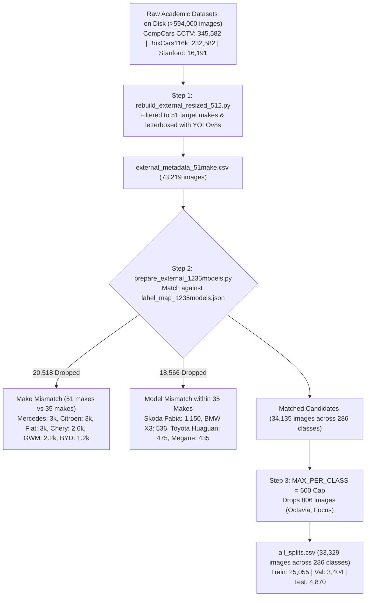

# Analysis & Plan: Why the Share of External Images is Low (3.0%)

## Goal Description
In the current merged dataset ([code/current/mobilenet/merged_dataset/splits_1235models/all_splits.csv](file:///home/researchadmin/Econ-n/repo-clone/vmmr/code/current/mobilenet/merged_dataset/splits_1235models/all_splits.csv)), the total count of External images is **33,329** (25,055 train, 3,404 val, 4,870 test), compared to **1,093,408** PlatesMania images. 

External images represent only **~2.96%** of the total dataset, and cover only **286 out of the 1,235 classes** (23.1%). This document provides the complete empirical root cause for this drop, tracing the data funnel from >594,000 raw files down to 33,329 rows.

---

## The External Data Funnel: >594,000 to 33,329



---

## 1. Five Concrete Reasons Why the External Share is Low

### Reason 1: The Initial Filtering to 51 Makes (594k $\to$ 73k)
The server actually stores **594,355 raw external vehicle images** under `/home/researchadmin/Econ/external_datasets`:
- `compcars_cctv`: **345,582 files**
- `BoxCars116k`: **232,582 files**
- `stanford-cars`: **16,191 files**

When `/home/researchadmin/Econ/scripts/rebuild_external_resized_512.py` was created, it selected only 51 consumer car makes (`TARGET_51_MAKES`). Hundreds of thousands of surveillance crops containing unidentifiable frames, obscure Chinese domestic brands, heavy commercial trucks, and duplicates were filtered out, producing **73,219 curated letterboxed images**.

---

### Reason 2: The 51-Make vs 35-Make Asymmetry (73k $\to$ 52.7k, -20,518 images)
The classifier's taxonomy (`label_map_1235models.json`) was derived strictly from PlatesMania's top vehicle classes, which contain **only 35 makes**.

`external_metadata_51make.csv` contained **16 makes that do not exist anywhere in the PlatesMania classifier**:
| Dropped Make | Dropped Images | Reason |
| :--- | :--- | :--- |
| **Mercedes-Benz** | **3,000** | Excluded from the 35-make PlatesMania manifest |
| **Citroen** | **3,000** | Not in 35-make taxonomy |
| **Fiat** | **3,000** | Not in 35-make taxonomy |
| **Chery** | **2,621** | Not in 35-make taxonomy |
| **GWM (Great Wall)** | **2,187** | Not in 35-make taxonomy |
| **BYD** | **1,177** | Not in 35-make taxonomy |
| **Jaguar** | **1,173** | Not in 35-make taxonomy |
| **SEAT** | **1,042** | Not in 35-make taxonomy |
| **Haval** | **952** | Not in 35-make taxonomy |
| **Dacia** | **663** | Not in 35-make taxonomy |
| *Others (MG, Tesla, etc.)* | **~900** | Not in 35-make taxonomy |

> **Impact**: **20,518 images (28.0% of the metadata)** were dropped instantly because their brand does not exist in the classifier's output heads.

---

### Reason 3: Model-Level Nomenclature & Class Mismatches (-18,566 images)
Even for the 35 makes that matched, PlatesMania's 1,235 classes do not contain the specific models present in external datasets:

1. **Missing Popular European Models in PlatesMania Taxonomy**:
   - `Skoda/Fabia`: External had **1,150 images**. The PlatesMania taxonomy contains **only `Skoda/Octavia`** (no Fabia, Superb, or Kodiaq). All 1,150 Fabia images were discarded.
   - `Renault/Megane`: External had **435 images**, but PlatesMania only had other Renault models.
2. **Naming Scheme Clashes (BMW Series vs Specific Models)**:
   - In PlatesMania, BMW is grouped by series: `BMW/1 Series`, `BMW/2 Series`, `BMW/3 Series`...
   - External datasets labeled BMWs as `BMW/X3` (536 images), `BMW/M3`, `BMW/328i`. `BMW/X3` is not an active class in the 1,235 label map.
3. **Regional Market Divergence (Chinese Domestic Market in CompCars)**:
   - CompCars features Chinese market names: `Toyota/Huaguan` (475 images), `Peugeot/408` (397 images), `Hyundai/Rohens Coupe` (372 images), which do not appear in European PlatesMania.

> **Impact**: Another **18,566 images (25.4%)** failed model matching, leaving only **34,135 images**.

---

### Reason 4: Zero External Data for 949 out of 1,235 Classes
Because academic datasets focus heavily on common global consumer cars (Honda Civic, Toyota Corolla, Ford Focus, VW Golf, BMW 3 Series), they completely lack the long-tail vehicle diversity found in PlatesMania:
- **PlatesMania**: 1,235 active classes (includes commercial vans, obscure trims, Russian/European variants).
- **External**: Matches only **286 classes**.
- **949 classes (76.9%)** have **zero External images**.

---

### Reason 5: The Per-Class Cap (`MAX_PER_CLASS = 600`, -806 images)
To prevent a handful of ultra-common cars (e.g. Ford Focus, Skoda Octavia) from dominating the external loss, `prepare_external_1235models.py` caps any class at 600 images:
- Dropped **806 images** from the top 3 classes.
- Final external dataset: **33,329 images**.

---

## 2. How the Pipeline Compensates for the 3.0% Share

If trained naively with standard random sampling:
$$\text{External Fraction} = \frac{25,055 \text{ (Ext Train)}}{875,199 \text{ (PM Train)} + 25,055 \text{ (Ext Train)}} = \mathbf{2.78\%}$$

A model seeing only 2.78% External data would treat External as negligible noise and overfit entirely to PlatesMania.

### The Solution: `WeightedRandomSampler` (`--ext-fraction 0.2`)
In [merged_dataset/train/train_mobilenet_v2_merged.py](file:///home/researchadmin/Econ-n/repo-clone/vmmr/code/current/mobilenet/merged_dataset/train/train_mobilenet_v2_merged.py#L130-L140):
```python
if args.ext_fraction > 0:
    weights = np.concatenate([
        np.full(n_pm, (1 - args.ext_fraction) / n_pm),
        np.full(n_ex, args.ext_fraction / n_ex)
    ])
    sampler = WeightedRandomSampler(torch.from_numpy(weights), num_samples=n_pm, replacement=True)
```
- In every 875,000-sample epoch, **exactly 20% (175,000 samples)** are forced to be External.
- The 25,055 unique External images are drawn **$\sim 7.0$ times per epoch with replacement**.
- Combined with heavy data augmentation (`--aug-strength strong`, color jitter, zoom, rotation), each repeated sample presents a different view to the network.

---

## 3. Potential Solutions If We Want to Expand External Data

If the project requires increasing the External volume from 33k to 100k+:

| Approach | Feasibility | Expected Yield | Trade-off / Cost |
| :--- | :--- | :--- | :--- |
| **A. Expand Model Aliasing Dictionary** | High | **+8,000 - 12,000 images** | Map BMW X3 $\to$ BMW/X Series (or add X3), Skoda Fabia $\to$ add class or alias, map US/Chinese market names. |
| **B. Relax the `MAX_PER_CLASS` cap** | Immediate | **+806 images** | Trivial, but increases class imbalance for Focus/Octavia. |
| **C. Add Mercedes-Benz & Top 10 Dropped Makes** | Medium | **+18,000 images** | Requires adding ~10 makes to the classifier output heads (1,235 $\to$ ~1,400 classes) and retraining. |
| **D. Mine the 345k CompCars & 232k BoxCars** | High | **+50,000 - 100,000 images** | Re-run `rebuild_external_resized_512.py` with broader criteria on the raw directories. |

### Recommended Plan
1. **Immediate (No Retraining Needed)**: Keep the existing 33,329-image split for Model C comparability, but accurately document the 5-layer funnel in `run_docs/` so future reviewers understand why External is 3%.
2. **For the Next Multi-Head Teacher Architecture**: Incorporate Mercedes-Benz and expand the model aliasing mapping in `prepare_external_1235models.py` to capture ~50,000+ External images.
